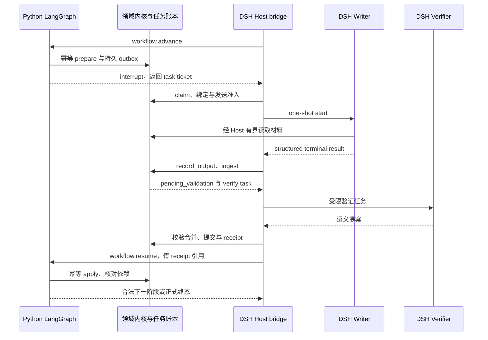
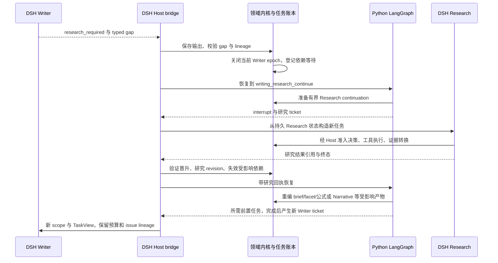

# Code2Paper × DeepSeek Harness：插件化改造设计与执行方案

> 审计与设计日期：2026-09-22；本次修订已核对本地代码与产物。
>
> Code2Paper：`hjcui98/code2paper`，本地分支 `codex/agentic-p4-benchmark-cutover`。首次审查为 `3aa9db8...`；本轮逐项设计研究基线为 **`4146010ac5c6ea21ace2bc0006741e4336242d1c`**。新增流程映射和 §21.2 绑定本轮快照，历史来源保留原 SHA；并行未提交修改另记于 §2.1。
>
> DeepSeek Harness：`deepseek-ai/deepseek-harness`，固定提交 **`c36a83ff6bb95e3f82cf79f9be7c724270a8aa61`**，包版本 **`0.1.7-alpha.1`**；本次 GitHub API 查询的 `master` 仍指向该提交。
>
> 状态：**方向已确认；节点映射、LangGraph 状态机、非阻塞任务交接与并发默认配置已按本轮研究收敛。尚未实施插件或验证模型兼容性；库级恢复探针不代表集成或生产切换通过。**

## 0. 结论与边界

**已确认的目标是：DSH 接管模型调用、工具循环、会话和 Agent 执行；默认业务流程继续沿用现有 LangGraph 主线；Code2Paper 保留领域表示、证据管理、合法状态转换、验收与产物提交。** 主 Agent 在既有阶段、依赖和修复路径内根据反馈行动；确定的下一阶段直接推进，不由模型每轮重新规划整个流程。并发开关只改变合法就绪任务的执行方式，不改变流程和验收合同。

本轮确定保留 LangGraph 库承载 Python 领域流程状态机，采用持久任务 + `interrupt`/回执恢复交接，DSH 负责图外 Agent 执行。独立 Writer PoC 是分期验证入口，不代表目标仅限于 Writer。一个调用原有完整 Agent 的工具可以支持回归和产物浏览，但不能验证原生模型—工具循环的收益。

推荐保留 Python 实现中的证据表示、意图对齐、机制上下文、公式包、依赖失效、验收和产物管理；将模型调用、交互、任务级子 Agent、会话压缩、受控执行和展示逐步交给 DSH。**不要为插件化把全部 Python 核心重写为 TypeScript，不要把每种 IR 或每个阶段独立发布成一个 npm 插件，不要在正常论文生成时允许 Creator Mode 修改自己的验证器。**

DSH 的 Creator Mode 是开发、配置和安装 Harness 插件的工作环境，不是专门的论文创作模式。实验入口采用独立、固定组成的 `code2paper` preset；Creator 用来辅助开发这个 bundle。官方仓库仍提示 developer preview，因此这里认可的是“可复用的现成能力”，不是声称其已经达到长期稳定生产平台的成熟度。[D01][D02][D03]

### 0.1 本文的证据范围

原稿读取了两边固定提交的关键代码、接口与测试源码，以及 2026-09-17 事故、2026-09-05 EBCAR 候选。此次补查本地 `publication_method_writer.py` 的实际调用链、独立请求/验收函数、语义验证 provider、authorship ledger，以及未提交的 2026-09-18 准入/用量产物；同时下载并核对 DSH 固定提交的 LLM seam、token meter、子 Agent driver 与结构化输出实现。不是两个仓库的逐行穷尽审计。[C11–C16][D18–D22][L01]

原稿“连接器无法读取巨型 Writer”的限制已由本地定点读取补足，具体锚点见 §21.2。首次复核副本位于 `/tmp/c2p-dsh-design-review-20260922/`；本轮源码快照、外部读取与库级探针位于 `/tmp/c2p-dsh-decisions-20260922-96d0m5mc/`。仓库仅修改设计文档与导航，没有安装依赖/插件、修改 GitHub、运行项目 pytest 或调用模型。新增零网络 LangGraph 恢复探针的范围和结果见 §26；历史回执不等于本轮复测。

以下标注约定：**“现有”** 指已读取实现或接口；**“已确认”** 指用户确认的设计方向；**“本轮确定”** 指用户要求逐项研究后收敛的实现设计；两者均不代表已实现。**“建议/待定”** 指未收敛安排；**“待验证”** 指尚须编译、回归或真实模型验证。设计中的新增接口不是现有 API。文件级证据和链接列于文末。

### 0.2 与现有架构规范的关系

本文遵循 [文档入口](README.md) 的权威顺序。07-19 总体设计规定研究状态、恢复和信任方向，08-17 主线计划 §18.1 明确要求 Master LangGraph + 现有 Research 子图。本次用户确认对 DSH 集成作执行层分工修订：由 DSH 运行 Agent，保留现有主线及后续已生效修订规定的默认流程语义、领域权威和质量门。该确认不把默认流程改为自由规划，也不要求预先删除 LangGraph 状态机。[P01]

落地时按 §6.4 的映射保留节点、条件边、回调和恢复语义；同一任务的派发、重试和每类状态各有唯一权威。本轮选择保留 LangGraph，由它推进约定的流程状态，Agent 任务通过 §15.7–§15.8 委托 DSH；不再将重写等价状态机作为首版的并列选项，也不继续隐藏运行原 Python 模型循环。

实施可从独立 opt-in adapter 分期验证，建议先接已冻结的 Writer 小任务。设计方向确认不等于生产入口切换或质量验收；等价性、恢复与质量证据以及相应迁移文档仍须齐备。本文不宣布 D5、rollout、default cutover 或 release freeze。

### 0.3 本次关键修订

| 原稿缺口 | 修订后的约束 |
|---|---|
| 执行层接管与默认流程被混为同一选择 | DSH 接管 Agent 执行，默认沿用既有主流程；实现承载与生产切换分别说明 |
| 主 Agent 可自由选择全局研究/写作阶段 | 阶段顺序、准入和修复路径来自现有合同，自主选择限定在合法动作内 |
| `outputSchema` 易被理解为 provider JSON Schema | DSH 通过 `structured_output` 工具收取结果；独立验证 tool-calling 和正文来源 |
| 模型 owner 表漏掉 Realizer、对齐与语义验证 | 登记全部模型路径；验证请求由独立角色执行，Python merge 保留裁决权 |
| 预算/身份到 WP4 才建设 | 最低发送门、持久回执与取消合同必须先于 WP3 live |
| “验收后提交”没有绑定实际模型输出 | 固定模型响应、tool-call 参数、字段来源与 lexical ledger 的映射 |
| 历史 tokens 可能被算作新调用 | 保留 `reused_evidence` 与本次发送双口径，补 import 闭包验证 |

### 0.4 已确认方向与本轮设计决议

本次讨论已经确认以下设计方向；后续实现应落实这些分工，而不是重新把 DSH 执行与既有流程列为二选一。

| 已确认事项 | 设计约束 |
|---|---|
| Agent 执行层 | DSH 接管模型调用、工具循环、会话及父子 Agent 执行 |
| 默认业务流程 | 继续沿用现有 LangGraph 主线的阶段、依赖、条件分支和修复回路 |
| 主 Agent 自主性 | 在当前流程允许的任务和动作中选择；确定的下一阶段直接推进，必需门不能跳过 |
| Code2Paper 领域内核 | 保留领域表示、证据管理、合法状态转换、验收及正式产物提交 |
| 并发控制 | 提供用户可见的显式开关，分别限制 Agent 任务与模型请求；串行模式完整可用，开关不改变流程和质量门 |

用户随后要求依据代码、产物与 DSH 情况逐项研究定案。本轮收敛如下：

| 设计项 | 本轮确定的方案与依据 |
|---|---|
| 默认节点映射 | 以实际 Research 图、当前产品入口和 Unified Writer 调用顺序共同建立映射；Authoring overlay 不冒充完整实际驱动，见 §6.4 |
| 流程状态机承载 | 保留 Python LangGraph + 持久 SQLite checkpoint；图内只有确定性准备、等待回执与状态合并，DSH 在图外运行 Agent，见 §6.3 |
| 任务交接和恢复 | 持久 outbox、受控 dispatch、结果入库、图恢复四步；正常写作与补证回路采用同一协议，见 §15.7–§15.8 |
| 并发默认值与范围 | 默认关闭；开启时默认最多 2 个独立 Agent 任务，后端请求默认最多 1 个；run 内开关与部署共享后端上限分别执行，见 §15.6 |
| 首次实现验证范围 | 采用 WP0 → WP1 → WP2 → WP4a → WP3 的独立 Writer 任务，先 mock/离线，再使用指定本地 Qwen 与冻结 EBCAR 小任务验证；本轮不启动实现或 live |

待实际验证的是 DSH Loader/工具调用兼容、端到端桥接、共享后端调度与故障恢复；生产切换仍按阶段证据评审。这些是验证事项，不再将已经收敛的四项设计悬置为待讨论。

具体 token 配额由 WP0 的实际请求计量和模型能力确定，并在首次发送前冻结有限上限。工作包规定实施与验证依赖，不是进度记录；本轮交付仍为设计文档。

## 1. 项目目标不能被通用 Harness 改写

任务保持：研究仓库 + 轻量作者指导 + 可选 inline marks → implementation-grounded Method draft + 描述相同方法逻辑的 overview/framework figure。作者意图决定叙事重点和抽象层次，但不能证明代码实现；代码标注是导航；代码、配置和脚本提供实现证据。正文为首要交付，图为同源的后续交付。本文评测设计要求 gold Method/figure 只进入独立评测端。[P01]

迁移的科学假设是：当领域表示和证据约束保留时，更完善的工具交互、按需检索、任务级记忆与续作机制，可能提升关键证据利用、局部纠错和整篇叙述质量。**插件化本身不是新的 Method 生成算法，也不构成质量提升的证据。**

验收必须同时回答：是否产生完整可用正文；是否忠实表达实现；是否保留作者主线；是否减少重复和工程化叙述；是否正确消费公式；是否与方法图一致；是否在可比预算内完成。不能只报工具成功数、页面 accepted 比例或连续运行时长。

## 2. 当前 Code2Paper 已经修了什么

首次审查从 `34ae0cf...` 对照到 `3aa9db8...`；下表保留当时确认的能力，本轮 `4146010...` 的流程补查见 §2.1、§6.4 和 §21.2。以下不应再作为“完全缺失能力”重建。

| 已读取位置 | 当前能力 | 迁移时的处理 |
|---|---|---|
| `agentic/authoring_execution_identity.py` | 引擎/目标/输入/模型/validator 身份、new/resume/fork 准入、run lease | 复用；补充 DSH 组成与实际调用身份 |
| `agentic/authoring_artifact_index.py` | `(logical_role, phase, generation)`、active 指针、字节摘要、合法空对象 | 扩展 producer 注册，不另建竞争索引 |
| `agentic/writer_output_workload.py` | 输入预算 + 输出任务量评估、段落与 detail occurrence、atom 不算 Writer 负担 | 复用；为 DSH 响应协议重新标定 |
| `agentic/writer_attempt_ledger.py` | 区分事件、发送、内容尝试和预发送拒绝；恢复状态与 unknown-send | 保留；适配 DSH 真实请求/响应回执 |
| `tests/regression_20260917/test_intent_writer_surface.py` | 空槽处理、作者正文到达 compact 表面、稳定 ID 下内容摘要变化 | 作为必须迁移的行为规格，不能只迁移类定义 |
| `agentic/product_authoring_graph.py` | 写作缺口回研究、问题 owner 路由、下游失效、独立修复预算 | 保留领域转换与失效规则；逐步替换旧执行驱动 |
| `llm/section_writer.py` | Writer 输入/结果、调用 trace、分层重试/输出预算协议 | 拆开“构造/验收”与“实际模型执行” |
| `build_publication_writer_request` / `assess_publication_content_acceptance` / `assess_publication_content_progress` | 已抽出的实际请求构造、局部内容验收与修复增益检查 | 首个 PoC 优先复用；局部接受不等于全文最终验收 |
| `semantic_verifier_provider.py` / `method_proposition_alignment_provider.py` | 独立语义判断及各自模型调用 | 迁移时必须显式纳入调用 owner 和预算 |
| `final_text_authorship.py` | 正文 lexical span 与允许生成角色、响应来源逐字绑定 | 增加 DSH 结构化工具参数来源，不用 closing message 代替 |
| `authoring_quality_report.py` / `authoring_quality_comparison.py` | 可复算指标、不可比/未测量状态 | 复用报告；新增 DSH 账本适配与独立语义评价 |

以上依据为源码与测试源码，**不是本轮测试运行结果**。本地 `offline-receipt.json` 记录了绑定 `3aa9db8...` 的 3767 passed、3 deselected；README 另记 12 subtests。这比只有提交说明更具体，但仍是历史回执，不是本轮复测。原稿不能再笼统写成“没有本地运行证据”，也不能据此宣布新 Writer live 通过。[C01–C07][C10–C16][L01]

还需要认识首次审查实现的范围：`authoring_artifact_index.py` 有已知文件名/代际表；`verify_research_import()` 当时主要检查 checkpoint 的身份字段存在并计算文件摘要；Writer 输出负荷有字符代理和经验系数。这些旧实现不能单独证明已有通用动态任务数据库、完整证据闭包认证和跨模型标定系统；身份/导入模块的并行增量须在 WP0 按实际完成的公共合同重新核对，避免重复建设。[C02][C03][C04]

现有 `prepare/execute-prepared` 是生产准备合同的重要基础，但不是可直接暴露的通用无模型 RPC；它依赖已完成 Formalizer checkpoint，且内部仍有多角色构造与执行分支。新 facade 必须明确输入前提，在测试中拦截所有 Python 模型/网络出口，证明所选 prepare/ingest 路径确实不发送。[C11]

### 2.1 复核期间的并行工作树增量

本次文档修订过程中，其他工作向 `authoring_execution_identity.py`、`live_admission_preflight.py`、`autonomous_method_agent.py`、`publication_method_writer.py` 等写入了未提交修改：目标身份改为源码内容摘要，增加有效配置摘要和来源不可用的准入阻断，并收敛 Narrative 模式解析。这些 diff 已只读核对并保留；不是本次文档任务实施的修改，也未在本轮测试。

首次复核的固定代码结论/行号绑定 `3aa9db8...`；后续 DSH adapter 应消费实际完成的公共身份/配置 owner，避免重复实现并行修复。DSH composition/角色/协议身份、研究导入引用闭包和实际模型 wire 仍须分别验证，不能从这些未提交增量推断已全部解决。WP0 开始时重取工作树内容摘要和通过回执。

在上一次方向确认落稿时，HEAD 已前进至 `95c50b3f2f73257582454b394ad36f5666fb3c31`，上述源文件不再显示为未提交修改；前两段保留首次复核时点的记录。当时未重新审计新提交的完整差异，不能把旧固定锚点或历史回执改标为新 HEAD 的验收结果。

后续逐项研究在 `4146010...` 建立新快照。Research、Authoring graph、产品入口、Writer、callback、checkpoint 及 section writer 的读取副本与该提交逐字一致，新增锚点见 §21.2。身份模块存在其他工作正在修改的内容；本文保存读取时哈希，不把该增量当已验证能力，也不改写它。读取后工作树仍可继续变化，实施须重新核对快照。旧产物仅支持恢复费用、历史失败与材料完整性分析，不证明当前 DSH 接入通过。[C18–C21][L04]

## 3. 产物告诉我们应该优化什么

### 3.1 2026-09-17 归档：长对话能力不能替代任务可行性

失败 run 的 join 页一次要求 16 段。首次只返回一段，结束原因为 `structured_complete`，并非达到输出长度上限；repair 补齐段落后仍没有满足两个 detail witness；后续尝试为账本耗尽后的预发送拒绝。最终 `publication_writer_result_v1.json` 的 `candidate_available=false`、`candidate_generation_status=not_started`、`publication_ready=false`。[A01][A02]

迁移必须保留的教训是：任务必须可写、实际材料必须到模型、detail/atom 责任必须一致、历史预算不能被会话重启擦除。**不能把这个旧失败当作新 SHA 已失败，也不能把 DSH 自动 compact 当成该问题的直接解法。**

归档目录元数据显示，统一 archive 为 5,296,158 bytes，Writer manifest 为 1,542,132 bytes，机制上下文集合为 2,328,677 bytes。它们应留在领域存储中，由 task projection 和有界读取提供给模型，而不是整份塞入父 Agent。[A03]

### 3.2 2026-09-05 候选正文：过门之后仍有叙事与公式问题

已读 EBCAR 候选中，masked attention 的访问限制在相邻架构段落重复表述；Training objective 标题下另有孤立的一行 InfoNCE 描述；annotated 版本将两个公式标为 `enters_verified=false` / `verified_eligible=false`。这些是旧候选的可见性质，不等于依据当前代码判定公式数学错误。[A04][A05]

因此应给 DSH 中的 Writer/Editor 真正的局部推理、取证和改写空间；最终保存“可读正文 + 机器可验 sidecar”。不要让新系统退化成“生成更多见证 JSON”或“把所有 accepted 页机械拼接”。

### 3.3 2026-09-18 本地产物：恢复成本必须区分复用与新发送

本地修复后用量产物记录：本次 `calls=0`、`total_tokens=0`，`reused_evidence.calls=45`、历史 tokens 为 1,221,200。准备阶段复制旧 invocation receipt，曾把历史用量算进 fresh run；当前已有复制摘要与复用标记。DSH 导入和恢复必须延续此区分，禁止用 Session 历史总量直接充当本次费用，也禁止把未知用量补成 0。[L02]

同目录的质量报告对事故只给机械指标：未测量忠实性，叙事仅有代理指标；没有完整新候选对照。这支持“先验证局部接入”的顺序，不支持“当前 Method 已经通过质量验收”。[L01][L03]

## 4. DSH 能复用到哪一层

| DSH 现有能力 | 可以直接承担的职责 | 不会自动替 Code2Paper 完成的事 |
|---|---|---|
| Cordis bundle、preset、persona | 可安装产品、角色工具/提示词组成、作用域生命周期 | 方法 IR 语义与论文任务定义 |
| Agent registry / Agent loop | 模型与工具多步交互、跟进/转向/取消 | 领域任务完成或科学事实正确 |
| Session / projections | 会话事件持久化和派生视图 | 正式证据库、完整的产品恢复状态 |
| Compaction | DSH 自己的模型上下文压缩和溢出恢复 | Python 内部独立 LLM 请求的压缩；证据无损替代 |
| Spawn / continuable subagent | 新上下文局部任务、受控延续、取消和结果收集 | 自动继承父工具限制；Method witness 验证 |
| File/search/LSP/shell | 浏览、导航、受控检查与运行 | 自动把任意工具文本变成 ResearchObservation |
| Goal / workflow | 在规定条件下继续工作，组织子任务 | 跨崩溃的领域任务恢复、独立事实验收、整棵调用树 token 上限 |
| Provider adapters / retry | 模型路由、传输恢复、调用事件 | “发送成功”和“正文被验收”之间的区别 |
| Deliverables / UI | 交付文件、显示任务/证据/结果 | 自动保证图文逻辑一致 |

证据来源：Agent 公共接口、tools 源码、compaction 源码、subagent 请求类型、workflow 与 goal 文档。[D04–D11]

两个容易漏掉的实际限制：`todo_write` 的视图在下一次 `turn/start` 会清空，因此只能作为当轮 UI 清单，不能保存科研运行的长期权威进度；Goal driver 在 resume/fork 后不会自动重新 arm，且明确没有独立 evaluator，轮数限制也不是 token/费用预算。[D10][D12]

## 5. 路线比较与选择

| 路线 | 作用 | 局限 | 结论 |
|---|---|---|---|
| DSH tool → 原 `method-agent` 全流程 | 快速统一入口，演示现有产物/状态 | 内部模型循环仍在 Python；无法自然享受 DSH compact/subagent | 仅作过渡审计、回归入口 |
| MCP 暴露领域读取/编译/验收 | 可被多个宿主使用 | 仅靠 MCP 不会接管宿主模型调用、会话身份和整体预算 | 可作为后续兼容出口，不作第一主通路 |
| Python 使用 DSH SDK | 适合小型实验或保留 Python 外层程序 | 若旧外层仍独立调度 Agent，可能形成双重控制；需重新划清状态归属 | 备选验证路径 |
| 原生 Cordis bundle + Python 领域 worker | 宿主负责真实 Agent 循环，领域规则可复用 | 必须认真设计任务边界、RPC、取消和回执 | **推荐目标** |
| 全量 TypeScript 重写 | 单语言 | 同时改语义、运行时、序列化和测试，风险最高 | 不建议 |

SDK 不是不存在；DSH 架构文档已有出进程 SDK 路径。这里选择原生 bundle 是因为用户需要原生会话、工具、角色和产品交互，而非否定 SDK。[D01]

## 6. 目标架构：既有流程约束下的 DSH Agent 执行

以下描述已确认的职责分工；具体接口和运行时承载仍是设计提案。默认流程沿用现有 LangGraph 主线，图中的 DSH 主 Agent 不是当前已实现的生产入口。建议首个 PoC 只接 Writer 任务边界，再按该分工逐步覆盖完整流程。

```text
用户 / Benchmark Runner
         │
         ▼
DSH code2paper preset
  ├─ 默认流程适配：沿用既有阶段、依赖、条件分支和修复回路
  ├─ 主 Agent：在当前流程允许的动作中选择任务与执行策略
  ├─ 原生局部 Agents：Research / Architect / Formalizer / Writer / Realizer
  │                   Editor / Rewrite / 独立语义验证 / Figure
  ├─ tools、sessions、compaction、approval、provider、交付 UI
  └─ Code2Paper bundle
       ├─ host bridge + 身份/权限绑定
       ├─ task/evidence/submit 工具
       ├─ 有界上下文与状态恢复投影
       └─ 请求计费/内容验收连接
                   │  版本化、受控 RPC
                   ▼
       Code2Paper Python 领域内核
         ├─ 流程准入、合法状态转换与 owner 路由
         ├─ 研究工具执行与 observation promotion
         ├─ 作者意图/机制/公式/叙事编译器
         ├─ 任务构造、预算、依赖失效
         ├─ witness/authority/图文一致性验收及验证提案的确定性合并
         └─ 正式产物与内容回执
                   │
                   ▼
       Frozen repo + durable run root
       Method candidate / annotated / verified / Figure IR & figure
```

**默认流程规定当前应进入哪个阶段及允许哪些回退，DSH 执行该阶段的 Agent，Code2Paper 判断动作是否合法及结果是否可提交。** 主 Agent 可在当前阶段选择先补哪个证据、如何检索、如何组织局部任务；仅在阶段和依赖已允许时选择章节顺序或并行任务。必需的 Formalizer、反向验证与发布条件不能由主 Agent 自行跳过。

领域状态机按当前阶段、准入结果、依赖和问题 owner 暴露 `allowed_actions`，执行确定性转换。若下一阶段已经确定，运行时直接推进，不额外调用主 Agent 重选全局流程；确需策略选择时才在允许集合内作模型决策。默认流程是可执行、可校验的合同，不能只写在主 Agent 提示词中。流程状态与会话状态分别保留，不能让两套运行时重复派发、修复或判定同一领域任务完成。

### 6.1 谁拥有哪种事实

| 事实 | 权威所有者 | DSH 可保存的内容 |
|---|---|---|
| 代码证据、source span、authority | Code2Paper 冻结证据与研究账本 | 摘要、引用、只读投影 |
| 默认阶段、合法后继与修复 owner | Code2Paper 流程合同及已提交领域状态 | 当前阶段、允许动作和调度回执；不得独立改写合法边 |
| Method 主线和段落计划 | Code2Paper 现有叙事产物 | task 所需的语义投影 |
| 会话发言、工具调用与模型请求 | DSH Session | 原始事件，保留自身 replay 语义 |
| 某次正文是否通过验收 | Code2Paper content-acceptance | 回执引用和 UI 状态 |
| 当前何时唤醒 Agent | DSH | Goal/用户授权的运行状态 |
| 正式产物可否发布 | Code2Paper publication decision | 可交付文件列表 |

### 6.2 默认主流程与有界自主执行

默认流程依据现有主线及后续已生效修订，保留阶段、依赖、条件边和回退语义。以下是业务阶段概括，不是要求所有运行机械经过全部节点；实际必需节点及可复用结果由当前合同判定，也不把旧文档已被修订的 Concept Card 路线重新设为默认。[P01][C10]

```text
输入、仓库冻结与作者意图
  → Research：研究计划、工具执行、证据编译与反馈循环
  → 研究准入与结果冻结
  → 论证/叙事规划、证据对齐与缺口处置
  → Formalizer（按当前义务）→ Writer（含所需 Realizer/绑定）
  → 反向验证与问题 owner 路由
  → Editor / Rewrite 与必要复验
  → Candidate / Verified 分流、作者确认事项、最终完整性门与正式提交

证据缺口 → 延续原 Research 状态 → 重编受影响产物 → 恢复受影响章节
公式/正文/表达问题 → 返回对应 Formalizer / Writer / Editor / Rewrite
需作者或外部材料的事项 → 保留待处理状态，按既有合同判断可交付范围
```

| 场景 | 默认行为与 Agent 可选择的范围 |
|---|---|
| 唯一合法下一阶段且准入满足 | 直接推进；不新增一次模型全局规划请求 |
| Research 阶段有多个待查问题 | Agent 在授权范围和预算内选择取证顺序、检索和工具策略 |
| 多个章节已具备写作条件 | 在流程允许的就绪任务中安排顺序；并发还须满足 §15.6 |
| Writer 返回证据不足 | 经既有回调及 owner 路由延续 Research；新证据使受影响下游失效，保留独立已接受结果 |
| 内容、公式或表达验收失败 | 返回对应 owner 有界修复；不能让主 Agent 改写正文、删义务或绕过验证来通过 |
| 恢复已完成阶段 | 核对身份、输入和回执后复用；未确认完成或已失效的结果不能因会话总结而跳过 |

这些选择均发生在既有流程合同内。流程之外的全局重规划不作为本设计的默认行为；调整阶段或合法边须形成明确的流程修订。Figure 按用户交付要求消费同源已接受技术内容，其依赖和验收同样受领域合同约束。

### 6.3 本轮选择：保留 LangGraph，Agent 执行移到图外

**采用 Python LangGraph + 持久 SQLite checkpoint，不另写等价流程引擎。** 依据是现有 Research 已使用真实 `StateGraph`、仓库已有 checkpoint 封装和依赖，本机安装的 `langgraph 1.2.8 / langgraph-checkpoint 4.1.1 / langgraph-checkpoint-sqlite 3.1.0` 已能完成本轮零网络、跨进程暂停恢复探针。另写状态机没有解决新的业务需求，却要重新证明路由、恢复和失效行为。[C18][C21][D25][L04]

这项选择不等于直接复用旧入口运行方式。`run_product_research_phase()` 当前构图未传 checkpointer，调用后依赖进程内 `last_result`；`persist_product_authoring_state_from_writer()` 主要从 Writer 已完成的产物重建 overlay，并只执行最终整理节点。旧 Authoring 默认 handler 多为状态推进，未知 route 还有回退到首个合法候选的逻辑。因此新 preset 必须注册完整领域 handler，拒绝缺失 handler、未知 route 和不可用 checkpoint；不能把现有 overlay 宣称为已经驱动全流程，也不能沿用静默后继回退。[C18–C20]

新适配器采用以下三个边界，合同拟定为 `c2p-dsh-workflow/1`：

```text
prepare：冻结输入，幂等写入 task/outbox
  → await_external：interrupt 返回 task/receipt handles，结束本次 graph.invoke
  → DSH Host 在图外运行 Agent，持久化原始结果并提交领域验收
  → apply_receipt：Command(resume=回执引用)，检查依赖并推进合法后继
```

`thread_id` 稳定绑定 execution 和对应主图/Research 子图；使用持久 checkpointer、严格 serializer 与 `durability='sync'`。图状态只存 schema 化状态和受验证的产物引用，不序列化活 Agent、client、锁或闭包中的 runtime。主图管理业务阶段，Research 子图管理该阶段的领域转换；二者是父子状态关系，不能同时拥有同一任务的派发权。Session 保存交互历史，任务账本保存执行/验收状态，LangGraph checkpoint 保存流程位置，各自唯一权威。

LangGraph 在 `Command(resume=...)` 后会从等待节点开头重执行。因此 `await_external` 的 interrupt 前不得发送模型、创建 child 或执行非幂等写入；prepare 独立成节点，apply 的提交也须幂等。任务投递按至少一次处理，正式提交按回执去重；不能从 checkpoint 的存在推导网络发送恰好一次。恢复协议及两个时序见 §15.7–§15.8。[D25][L04]

旧流程的有效业务产物可经身份/闭包校验导入；旧 checkpoint 不直接作为新合同的可执行 checkpoint。保留原驱动作回归参照，新 opt-in preset 缺依赖时明确拒绝，不静默退回 Python Agent 循环。

### 6.4 默认节点映射：实际驱动、领域 owner 与 DSH 任务

映射绑定 `4146010...` 快照。下面的“并发”均指 §15.6 开启后的**可调度条件**；默认关闭。Python 的领域状态合并始终单写者，表中“纯内核”不会为了形式完整而新增模型 Agent。模型任务只提出候选，正式状态仍由内核决定。

#### 6.4.1 输入与 Research 子图

输入端先冻结 repo/config/作者约束。当前 `build_product_research_runtime()` 内的 intent enrichment 也会调用模型，应拆为 DSH `plan` 角色的意图解释任务，再由内核校验合并；该提案不能修改作者输入或提升其证据权限。初始化失败或作者信息不足保留明确状态，不能默默吞掉后继续研究。[C20]

| 现有节点 | 执行归属与输入 → 产物 | 保留的门、后继与失败 owner | 并发 |
|---|---|---|---|
| `linear_prefix` | 内核：输入解析、仓库索引、agenda 构造 → 研究初始状态 | snapshot/intent 身份；进入 `research_supervisor` | 同一研究实例串行 |
| `research_supervisor` | DSH Research 产生下一步提案；内核消费 `ResearchDecision` 并做 policy merge | 合法工具/scope/预算；保留当前一次 policy rejection repair；随后 tool、gap 或终止 | 同一逻辑 Research 状态只接受一个决策 |
| `research_tool` | DSH 注册工具调用内核 `execute_research_tool` → observation | 工具准入、源码范围、证据身份；工具错误返回 Research owner | 首版按已准入决策顺序执行 |
| `observation_pipeline` | 内核：observation 标准化、行为图/覆盖更新 → 新研究状态 | 非法来源不晋升；进入 `evidence_critic` | 状态合并串行 |
| `evidence_critic` | **现有为确定性判定**，保留在内核 | blocked/ready_to_author → terminator；gap → gap_finalizer；compile/search/inspect → 对应边 | 不新增 Critic 模型请求 |
| `compile_candidate` | 内核：packet/fact/decomposition/authority 编译 → candidate 与缺口 | 保留目标对齐；已启用的模型语义检查另成 DSH verify 任务，结果回来再 merge | 编译提交串行；独立验证可排队 |
| `gap_finalizer` | 内核：搜索闭合与显式缺口记录 → gap receipt | accepted → advancer；rejected → supervisor；blocked → terminator | 串行 |
| `obligation_advancer` | 内核：选择尚未满足的义务 → 当前 agenda 指针 | 有下一项 → supervisor；无 → terminator；不能丢弃失败义务 | 串行 |
| `terminator` | 内核：封装状态、材料与停机原因 | END 不等于 authoring-ready；后续单独做研究准入与冻结 | 串行 |

保留 `research_graph.py` 的条件边与 `research_nodes.py` 的领域转换，但拆掉 `research_supervisor_node()` 内的 `backend.decide()` 和模型 repair 调用。**Research Agent 的思考—工具循环只运行在 DSH。** 新研究工具适配层把 DSH 行动参数规范化成决策提案，先执行 policy admission，再执行受准入工具，再推进 observation/critic/compile 等确定性节点；到下一个外部提案边界即返回，Python 不自行调用模型继续循环。`record_gap`、stop 等动作也经过相同领域准入，而非靠自然语言宣告。[C18]

研究阶段内的每次工具调用是短 RPC；整个有界 Research 任务可包含多个原生模型/工具步骤。Research loop 状态及 observation refs 必须持久化；重建 `_ResearchGraphContext` 所需内容来自这些引用，不以进程内 `last_result` 或 DSH 摘要为恢复依据。若编译遇到独立语义验证，挂起该任务并派发受限 verify，保留原 Research 逻辑状态；验证结果合并后再允许 Research 继续，不能把同步模型 callback 留在工具里。

#### 6.4.2 写作主线与回退节点

下表覆盖当前 Authoring overlay 的全部 16 个命名节点，同时指出实际生产入口的子步骤。既有 `architect → section_formalizer → section_writer` 粗粒度依赖保留：`architect` 提供初步机制/叙事义务，**Unified 当前在生成公式包后才完成 `_build_narrative_plan_v3()` 的细化**。因此最终 Narrative 编排放在 Writer 准备阶段、Formalizer 回执之后；前后是同一计划的版本化细化，不建立两份竞争的主计划，也不把旧 overlay 顺序当成实际调用证据。[C19][C20][C22]

| 阶段 / 现有节点 | DSH 与内核分工、输入 → 产物 | 完成条件 / 失败路由 | 并发 |
|---|---|---|---|
| `research_frozen` | 内核：研究终态 → frozen research/checkpoint/closure receipt | 研究准入、来源与引用闭包通过；未通过留在研究/blocked | 单写者 |
| `brief_compile` | 当前 `build_product_planning` 的 brief 编译留内核；其可选模型 planner 转 DSH plan → argument briefs | 作者意图不能授权实现事实；提案失败返回 plan owner | 首版串行 |
| `facet_decompose` | 内核：brief → facet/义务集合 | 保持 scope、覆盖和稳定 ID | 纯编译，无 Agent |
| `facet_evidence_align` | 内核执行对齐；所需语义提案交独立 DSH verify → evidence links | 缺证据交 `writing_gap_router`；不能靠放宽匹配通过 | 独立验证可并行 |
| `writing_gap_router` | 内核：gap/预算/材料来源 → owner route | 仅 `writing_research_continue`、`mechanism_planner`、`author_review_items` 等已定义合法结果 | 单写者 |
| `writing_research_continue` | DSH Research 处理有界 callback；内核验收新证据、失效下游 → 新研究 revision | 通过后回 brief/受影响编译；失败保留缺口，不能无限重开 | 同一 Research 状态串行 |
| `mechanism_planner` | 内核编译机制上下文；启用的模型提案交 DSH plan → mechanism/coverage/公式义务 | 只消费已准入材料，修复回相应 plan/Research owner | 首版串行 |
| `architect` | DSH plan 或已有确定性计划投影 → 初步篇章结构/段落职责 | 当前配置决定是否需要模型；不能为纯投影增加调用 | 全文计划串行 |
| `section_formalizer` | DSH formalize → 公式包；内核检查义务、来源与资格 | 未需公式时以合同明确跳过；失败回 Formalizer，缺证据回 Research | 冻结输入、独立公式义务可并行 |
| `section_writer`：准备与生成 | 公式回执 → Narrative 细化、分页和请求材料；模型细化走 DSH plan，生成走 DSH write | 先过任务可写性、输入/输出预算，再验收正文与 detail；返回 write/research_required/blocked | Narrative 串行；无相互依赖的冻结 Writer 单元可并行 |
| `section_writer`：Realizer 子步骤 | DSH realize 提案；内核做 atom/operation 对齐和约束检查 | Realizer 无正文措辞权；失败归对应 owner，不能由内核编造词句 | 独立单元可排队，状态合并串行 |
| `reverse_validate` | 内核固定正文/claim/evidence；独立 DSH verify → 语义提案；内核 merge | qualifier、numeric/formula、authorship、reverse-validation 等仍 fail-closed | 独立验证可并行，裁决串行 |
| `issue_owner_router` | 内核：验证问题 → 已定义 repair owner 与预算 | Research/Formalizer/Writer/Editor/Rewrite/review；未知 owner 阻断 | 无额外全局规划模型 |
| `editor` / `rewrite_method_language` | DSH edit / rewrite → 新正文；内核做语义差分、来源登记与依赖失效 | 正文变更必需复验；不能沿用旧绑定直接到分流 | 涉及同一全文版本时串行 |
| 最终 Binder（产品分流前） | 内核：最终接受的段落/公式/计划 → `_write_unified_v2_binder_receipts` | 当前实际调用在 `:8447`，位于最终验证处理后、publication status 计算前；缺少或失败回执不可被 Writer 成功掩盖 | 单写者；正文变化后必须重建 |
| `split_candidate_verified` | 内核：已验收正文、资格、review 项 → 两种交付状态 | Candidate 与 Verified 分别判定；必需 final-integrity 未通过不得发布 | 单写者 |
| `author_review_items` | 内核整理仍需作者/外部材料的事项与产品终态 | review 是明确终态/暂停依据，不能当作所有 gate 已通过 | 单写者 |
| 正式提交与 Figure 后续 | 内核事务提交已接受正文/sidecar；DSH figure 消费同版本技术内容 | 先正文合同，再同源图文一致性；完成度由领域结果确定 | 首版在正文版本冻结后串行接入 |

既有 owner 路由、Candidate 例外及 final-integrity 条件取自现行规范；表格只分配执行责任，不另写较宽松的验收。对不需模型的 `architect` 等路径使用确定性投影，对配置启用的模型 planner/semantic revision callback 则登记明确任务，不能既隐藏旧调用又报告“Python 无 LLM”。`fulfill_and_resume_writing_callbacks()` 当前包含循环及同步 Writer 续跑，须拆为回调验证、研究任务、依赖重编、写作任务四段，不能整体包装为 `c2p_request_research`。[C20–C22]

## 7. 插件结构：一个可安装 bundle，不做“全模块插件化”

以下目录全部为**建议新增**，不是当前仓库已有路径。

```text
integrations/dsh/
  package.json
  cordis.patch.yml
  src/
    index.ts                  # apply/inject、注册和清理
    kernel-client.ts          # RPC、受控进程、取消、重连
    task-tools.ts             # schema 校验的 model-facing tools
    role-dispatch.ts          # 子 Agent 请求、persona/toolFilter/outputSchema
    workflow-driver.ts        # run-owned pump、claim/result/receipt、图恢复
    context-policy.ts         # 有界语义投影及可重放状态恢复
    request-accounting.ts     # DSH 调用 → domain reservation/receipt
    execution-policy.ts       # 显式并发开关、任务队列与后端共享请求限流
    session-binding.ts        # session/child/task/execution 显式绑定
  presets/                    # 生成配置的素材，不冒充 DSH 自动扫描路径
  skills/
    research-method-evidence/SKILL.md
    write-grounded-method/SKILL.md
    plan-method-figure/SKILL.md
  tests/
    loader-smoke.test.ts
    tools-contract.test.ts
    role-scope.test.ts
    cancellation.test.ts
    session-recovery.test.ts

src/code2paper/integrations/dsh/
  __init__.py
  protocol.py                 # 新 transport models，不另造技术 IR
  worker.py                   # 无 LLM 的协议入口
  facade.py                   # 复用现有领域模块
  workflow_adapter.py         # LangGraph prepare/interrupt/apply 与默认流程映射
  task_store.py               # 持久 task/outbox/claim，引用现有产物索引
  backend_scheduler.py        # 同主机共享 SQLite 请求队列与 permit
  task_projection.py          # 生成 TaskEnvelope
  result_ingest.py             # 验证、失效、提交
  invocation_adapter.py       # DSH request facts → 领域回执

tests/integrations/dsh/
  test_wire_schemas.py
  test_prepare_submit.py
  test_recovery_identity.py
  test_snapshot_authority.py
  test_evidence_isolation.py
```

逻辑上分四块：领域 service、工具、运行政策、展示；第一版仍可在一个包内。领域编译器无需全改成 Cordis Service，也不需要为每个 JSON schema 发布一个包。

### 7.1 bundle 与 preset 配置草案

下面采用已核对的 `dsh.bundle.patch` 和 `insert` 方言；包名与 export 路径是本次拟定，正式安装前须构建并通过固定 DSH 版本 Loader smoke。[D02][D03]

```json
{
  "name": "@code2paper/dsh-bundle",
  "version": "0.1.0",
  "private": true,
  "type": "module",
  "exports": {
    ".": "./lib/index.js",
    "./tools": "./lib/task-tools.js"
  },
  "dsh": { "bundle": { "patch": "./cordis.patch.yml" } }
}
```

```yaml
- insert:
    - id: code2paper-kernel-bridge
      name: '@code2paper/dsh-bundle'
      config: {} # 新 Config 由实现定义；必须显式校验 worker 与存储配置
    - id: preset-code2paper
      name: '@deepseek-ai/dsh-agent-preset'
      config:
        id: code2paper
        name: Code2Paper
        description: Author-guided, implementation-grounded Method authoring
        plugins:
          - id: code2paper-tools
            name: '@code2paper/dsh-bundle/tools'
            config: {}
```

这是集成骨架，不是可直接运行的完整 package：正式版本还须声明实际导入的 Service Definition 依赖/peer 依赖、构建与兼容范围，保证 preset registry/base 服务已存在。不要复制 DSH monorepo 的 `workspace:^` 到一个独立发布包里。

现有 profile 的 matching override 会替换整个 `config`，不能把上面的片段当作任意字段深合并。先检查 composed config；不要覆盖用户的 provider、credentials 或已有插件。Creator 的安装应走 `plugin_manager` 的 `install_bundle`，安装新包、替换已安装包、HMR 和 restart-required 必须分别处理。[D03]

### 7.2 可复现安装与模型能力前置检查

`private: true` 的首版通过本地目录/打包文件试装；若后续发布 npm，再定义发布清单与版本策略。`compatibility.json` 至少固定 DSH SHA、实际安装包版本/锁文件摘要、bundle 构建摘要、Python wheel/依赖与协议版本。当前 DSH 根包要求 Node `^22.19.0 || >=24.0.0`；不能只写“安装 Node”。冻结版本只声明此组合支持，不默认兼容后续 alpha。[D11][D23]

加载检查须覆盖 `agent`/loop、preset registry、`llm`/adapter、tools、subagents/spawn、subprocess 与会话存储等实际依赖。目录中的 `skills/` 不会自行进入 prompt，必须显式挂载并检查可见内容；bundle 服务、preset 内工具、child 局部身份的作用域分别验证。

现有 Qwen profile 声明 `native_json_schema` 和 131072 context，**没有由此证明 DSH 的 tool-calling 兼容性**。PoC 先用 mock 验证协议，再对指定的 `8006/qwen38-27b-nvfp4` 单独检验普通工具调用、`structured_output` 参数、usage/finish、取消与真实 tokenizer。Python 目前可发送 `top_p`、`chat_template_kwargs`、`thinking_token_budget`，DSH `GenerateOptions` 不直接提供这些字段；`llm-pi-ai` 已有 `compat`、`thinkingTokenBudgetField` 和模板参数配置，优先核对这些现有能力，再证明实际 wire/服务端配置等价或记录差异。缺能力就停止该模型的可比试验，不能静默改用另一模型或关闭要求。[C17][D15][D18][D20]

## 8. 插件应暴露什么工具

不要把 `compile_v2`、`adapt_v3`、`revision_2` 一股脑暴露为模型选项。模型应选择“补证据、解释公式、写这一组段落、修复某项问题”，版本轴和投影过程由内核处理。

### 8.1 公共工具集（均为设计名称）

| 工具 | 输入主项 | 输出主项 | 是否可推进领域状态 |
|---|---|---|---|
| `c2p_state` | 当前绑定 run；可选 section | 阶段、任务/验收状态、未解事项、预算、合法动作、并发有效值、产物 handles | 否 |
| `c2p_prepare_task` | task kind、section/issue 目标、expected revision | TaskEnvelope、task digest、准备回执 | 是：预备，不调用模型 |
| `c2p_read_artifact` | artifact handle、范围/cursor | 完整或明确分页的局部内容、来源/摘要 | 否 |
| `c2p_submit_result` | task id、候选对象/受控 artifact handle、expected revision | accepted/rejected/pending_validation/补证状态、问题 owner、相应回执 | 是 |
| `c2p_request_research` | 当前任务中的缺口、所需证据种类 | 有界研究任务及依赖影响 | 是，不等于补证成功 |
| `c2p_dispatch_task` | 已准备且当前可派发的 task id | 立即返回 queued/running ticket；完成后按 handle 查结果/领域回执 | 是：请求同一个 Host pump，禁止递归全流程 |
| `c2p_export` | artifact set / requested output tier | 可交付文件、验证状态、未解事项 | 仅对已获授权的产物发布 |

研究角色额外以独立、窄 schema 暴露现有 `find_entrypoints`、`search_symbols`、`read_symbol`、`find_references` 等，全部经 §6.4.1 的决策准入适配层进入现有 `execute_research_tool`。`record_gap`/stop 等控制提案由窄工具 `c2p_research_step` 承载；它只推进到下一个外部提案边界，不内部运行 Research Agent。现有 `close_search_frontier`、`record_explicit_code_gap` 的搜索闭合与负面结论规则也不能丢掉。[C08][C18]

公共工具不代表所有角色均可见：读取按 task scope；prepare/dispatch/request_research 由流程角色或 Host 受控使用；Writer 通过 terminal 结果报告 draft/缺口；submit 统一进入验收。`workflow.resume`、claim 及后端 permit 只提供给已绑定 Host，不注册为模型工具。

### 8.2 身份不要由模型自报

`execution_id`、实际 caller/session、snapshot、authority scope 和预算上限由 Host 的绑定层注入；模型只能选择已授权资源中的目标。模型传入同名字符串，不能因此获得另一个 run 的权限。`task_id` 是定位符，不是授权令牌。

每个成功的 DSH 工具必须返回合法 canonical JSON，`output.render()` 只是模型可见摘要；对领域 rejected 结果应明确返回 `domain_status: rejected` 和恢复动作。**工具调用正常返回、不代表领域任务 accepted。** 核心验收在 `result_ingest` 内执行，不能只用可被其他插件替换的 post-hook 充当验收。[D05]

### 8.3 Schema 转换

DSH `defineTool` 的便捷参数描述（示例属性内 `required: true`）与标准 JSON Schema 不同；低层 `tools.register` 的 `ToolSchema.parameters` 及子 Agent `outputSchema` 使用 JSON Schema，后者还受 `assertObjectJsonSchema` 子集约束。先选择一种注册通路，再显式处理 Pydantic 的 `$defs/$ref`、nullable、union、enum 与 extra-forbid；同一候选必须经过 Python 原始模型复验。不支持的 schema 可以拆成明确的工具/任务契约，不能靠删除约束完成转换。[D05][D12][D14][D19]

一期固定采用 **原生工具模式**，不同时引入 PTC、动态生成工作流和一整套 schema 改写。后续 PTC 可复用同一 typed tool registry，但每个子 dispatch 仍必须经过绑定/权限/记账，不能绕过原生通路。

## 9. TaskEnvelope：新增的是执行载体，不是第五套方法表示

下面是拟定的核心 wire model（字段语义规格，最终命名由实现冻结）。

```python
class C2PTaskEnvelopeV1(BaseModel):
    protocol_version: Literal['c2p-dsh/1']
    execution_id: str
    task_id: str
    workflow_version: Literal['c2p-dsh-workflow/1']
    workflow_node: str
    task_epoch: int
    task_kind: Literal['research', 'plan', 'formalize', 'write', 'realize',
                       'edit', 'rewrite', 'verify', 'figure']
    task_digest: str
    expected_state_revision: int
    source_snapshot_digest: str
    narrative_plan_digest: str | None
    validator_bundle_digest: str
    section_id: str | None
    paragraph_ids: tuple[str, ...]
    objective: str
    local_author_surfaces: tuple[dict, ...]
    evidence_handles: tuple[str, ...]
    formula_handles: tuple[str, ...]
    required_occurrences: tuple[dict, ...]
    allowed_actions: tuple[str, ...]
    response_schema_handle: str
    max_request_input_tokens: int
    max_output_tokens: int
    remaining_content_attempts: int
```

上述仅展示字段；实现要增加严格 extra-forbid、非空/范围约束、结构化 occurrence 类型与 schema 导出。不要把任意 `dict` 留作最终未校验通道。

`task_kind` 是设计全集，第一版只注册 `write`；未实现种类明确拒绝。Narrative 尚未产生的 Research/早期 plan 允许其 digest 为空，Writer 则必须具备当前合同要求的计划引用；这些约束按 kind 交叉验证，不用占位字符串绕过。技术依赖的 typed read-set、角色合同、期望输出 tier 和证据 scope digest 必须进入 task digest，定义 schema 后与上述字段一起冻结。`expected_state_revision` 表示领域内容版本，prepare、预算预留和只读操作不应自动推进它，否则任务刚准备就会被自身的账本写入标成 stale。首版串行写任务；后续并发按实际依赖 digest 检查冲突，不能只凭一个全局递增计数使所有兄弟任务相互失效。

### 9.0 结果合同必须能表达“需要材料”

首个 write 任务新增严格的 `WriterTaskResultV1`：`outcome = draft | research_required | blocked`。`draft` 分支才包含既有 Writer 结构；`research_required` 绑定 typed gap/目标；`blocked` 给出稳定原因和恢复动作。其他 kind 分别定义 plan/formula/realization/verification/research 的 typed 结果，不能复用 Writer schema 强迫所有 Agent 产正文。Research 的 `dependency_wait` 只能引用内核已经登记的验证等依赖，不准模型随意创建未授权依赖。`accepted`、authority、caller 和预算不是模型可填写的裁决字段。若 DSH schema 子集不支持预期 union，改成显式状态字段并由 Python 交叉约束，或拆为互斥工具，不删除校验。

取证请求提交后暂停当前 task；新证据晋升后关闭旧 task，按新 scope 准备下一 task，保留 issue lineage 与已消耗额度。单纯再次读取现有授权证据不改 revision。这样 one-shot Writer 可以合法报告材料不足，不必编造正文来满足只容许“成功对象”的 schema。

**模型实际可见的 TaskView 至少有四部分：**

1. 本段要回答什么，作者在此处具体想说明什么，而不只是 story ID。
2. 有证据支持的机制、输入输出和条件，引用哪些可再读取的精确源码。
3. 本段必须表达哪些 detail、可消费哪些公式，以及哪些事项只能写为作者说明或尚未证实。
4. 输出边界和相邻段落的衔接信息，避免每个局部 Writer 重复讲 overview。

TaskView 直接复用现有 `author_intent_surfaces`、`paragraph_kind`、`disposition`、`implementation_status`。每次 projection 生成测试应比较 **实际发给模型的内容**，不能只比较上游模型里是否存在字段。[C06]

### 9.1 不要求模型同时输出全部绑定

Writer 负责 prose、detail occurrence 与适用的 formula consumption；Binder 负责 atom/精确实现链。一个 atom witness 不能自动替代一个 detail 已被充分表达的结论，反过来也不能要求 Writer 再输出全部 Binder 数据。保留 `(paragraph_id, target_kind, target_id, validation_stage)` 的身份维度。[C01][C04][C05]

### 9.2 任务粒度不是整节硬上限

先形成有局部语义的正文单元，再由输入闭包与输出负荷联合打包。当前经验上限 6 与首次通过边界 2 来源于旧 incident，不是跨模型定律。DSH 的工具参数、structured output、reasoning 输出计费方式改变后，必须重新测量实际请求和输出。[C04]

全文框架、术语定义和邻接衔接由小型共享视图提供；大证据从有界工具读取，不通过不断增加父会话长度解决。页、段落片段和 section 是执行/叙事的不同层级，不能让物理分页自行改写作者主线。

## 10. 现有代码如何拆，不再形成双 Agent 循环

### 10.1 关键障碍：同步 `_LLMCaller` 不是 DSH Agent

当前 `llm/section_writer.py` 的 `_LLMCaller` 是同步 `(LLMConfig, LLMRequest) -> LLMResponse`；默认直接调用 `LLMClient.complete()`。它还拥有重试、长度升级和累计输出预算。把这个函数换成另一个 endpoint，并不会让其调用进入 DSH 的 Agent loop。[C07]

目标拆分为下列**新边界**：

```text
prepare_write_task(existing_inputs)
    -> frozen task + actual model-facing TaskView + output schema

DSH native child executes the task
    -> model/tool request events + structured result

ingest_write_result(task, provider_facts, result)
    -> existing parser / transaction assessor / content receipt
```

模型调用由 DSH 发起，Python prepare/ingest 都不得暗中调用 LLM。旧同步 caller 可以暂时作为参考适配器保留，用于旧 CLI 和回归对照，但不是新 preset 内部默认落回路径。

### 10.2 单一模型调用 owner

| 能力 | DSH 模式下执行 owner | Code2Paper 保留 |
|---|---|---|
| 输入意图 enrichment | DSH plan 的受限提案 | 原始作者约束冻结、合并和 authority 区分 |
| 研究下一步/工具调用 | DSH researcher | 工具 observation、promotion、缺口和闭合规则 |
| Research policy rejection repair | 原 Research owner，在既有有限预算内 | policy merge、拒绝原因及再次准入 |
| Narrative/Mechanism 的模型提案 | DSH 对应任务 | 确定性编译、authority、投影与依赖 |
| Formalizer 模型推导 | DSH formalizer | 公式义务、来源、消费与验收 |
| Writer 生成/局部 repair | DSH writer | 实际材料构造、输出验收、尝试预算 |
| Realizer 的模型提案 | DSH realizer，独立受限任务 | atom/operation 对齐及内容约束；不能获得正文措辞权 |
| Binder 确定性绑定 | Python 内核 | `_write_unified_v2_binder_receipts`、claim/formula identity 及反例检查 |
| Proposition alignment / semantic verifier | DSH 独立 verify 任务 | 冻结的 claim/evidence 输入、提案合并、最终 fail-closed |
| Research revision semantic callback | DSH 独立 verify 任务 | revision 绑定、失效和语义裁决；不能留作同步 Python 模型 callback |
| Editor/语言改写 | DSH editor / rewrite | 语义差分、重新绑定、失效和发布检查 |
| Figure proposal | DSH figure worker | EvidenceBackedFigurePlan、证据关系和文本一致性 |

不能保留“DSH 先修一次、Python 内部再修一次、外层 Goal 自动另起一次”而只记一次失败。工具失败需要判定是资源/传输、材料缺失、格式、语义、身份还是预算，不同类进入对应 owner。

这里的 owner 表是迁移目标。当前 `_maybe_validate_final_text` 会构造 `build_llm_semantic_verifier`，`_audit_proposition_alignment` 会创建模型 aligner；仅替换传入 Writer 的 `llm_caller` 不能接管这些调用。新 ingest 遇到需要模型验证的内容时应先持久化为 `pending_validation`，返回绑定正文/证据/validator digest 的验证任务，再由独立角色生成提案、内核完成合并。禁止为了“Python 无 LLM”把 verifier 置空，或让 Writer 自己提交 supported verdict。[C11][C13]

首个 Writer PoC 只声称局部 transaction 接受；接入 Realizer/Binder 与最终验证以前，不对外设置全文 `candidate_complete`、`verified_complete` 或 `publication_ready`。

### 10.3 Writer 局部工具权限

Writer 可以提出明确取证请求，查看当前 task 授权的证据、公式与必要的相关代码；不需要永久禁止接触代码。但新观察必须经内核晋升，改变有效 evidence scope 时显式产生任务/计划 revision，并使受影响结果失效。

必须区分“解释目前这条已授权证据”和“把一个新发现加入正式证据集合”。前者不应每次重新全仓库研究，后者不能靠模型在回答中随手写一个 evidence ID 就完成。

### 10.4 输出适配必须保留正文作者来源

现有 authorship ledger 要求 `GeneratedTextSpanV1` 的 `owner`、`response_ref`、`generation_trace_id` 与最终 lexical span 对应。DSH 的结果适配需保存：execution/task/epoch、child session、turn/step/本地 attempt、实际 provider response、`structured_output` tool-call ID、原始参数摘要、schema 与解析版本、正文所在 JSON pointer。解码 JSON 转义是表示恢复；补句、改 qualifier 或替换公式是内容修订，必须返回允许的生成角色。[C14][D19]

`SubagentResult.structured` 没有足够的 usage、响应来源和 authorship 信息，必须结合可信 Session settlement 与调用账本。`LLMResponse` 的兼容对象只能承载实际观测字段：不要伪造 `finish_reason=structured_complete`，不要把重新序列化 JSON 的 hash 冒充原始 provider 响应 hash。原始字节摘要、解析对象摘要和最终正文摘要分别保存。

主 Agent 的总结、RunCapsule、工具摘要和 deterministic assembler 都没有技术正文措辞权。它们可以引用已提交 Writer 文字，但不能产生新句子后标成 Writer。编辑后的文本和来源 ledger 必须在同一提交中更新。

## 11. 原生子 Agent：使用现有请求契约，而不是假想接口

已核对的 `SubagentStartRequest` 字段包括 `prompt`、`parent`、`signal`、`agentOptions`、`outputSchema`、`maxDepth`、`toolFilter`、`persona`。不包含一个可随意传入的 `preset` 字段。因此一期由 Code2Paper 的 `role-dispatch.ts` 把已冻结角色配置转成这些现有字段；不要设计 `agentOptions.preset='writer'` 后再期待 DSH 接收。[D14]

```typescript
// 设计接口：任务与角色由 Code2Paper 绑定；返回 DSH 的真实请求类型。
function makeRoleRequest(
  parent: Agent,
  task: C2PTaskEnvelopeV1,
  scope: BoundTaskScope,
  signal: AbortSignal,
): SubagentStartRequest
```

内部使用已有 `spawn` provider，`prompt` 是 `ContentBlock[]`，fresh task prompt 必须自包含；persona 用于写作职责，toolFilter 采用最小角色工具集合，outputSchema 固定返回形状。`maxDepth` 是绝对子代深度上限，不是模型请求次数或 token 预算。启动前检查 provider advertised capabilities，不支持时明确失败，不静默去掉约束。[D13][D14]

**注意：fresh spawn 并不自动继承父 Agent 的临时工具限制。** 当前 `applyChildComposition()` 会通过 `agentPresets.composeFrom(childCtx, parent.ctx)` 接入父 preset，再施加子角色 persona/toolFilter；共享 preset 不等于复制父权限。因此需要在 preset 注册工具后验证 child 实际可见和可执行集合，并在每个领域工具里检查 Host 绑定。delegated sandbox/approval 另按其契约执行，工具列表不是 OS 安全边界。[D07][D13][D22]

以当前 `tools.view()` 实现为准，过滤作用于 global/ancestor 继承工具，child 自己注册的工具保留；`structured_output` 正依赖这个规则。不要把尚未注册的局部 terminal 工具写入 `toolFilter.allow`，这可能触发 unknown-name 校验。需用 smoke 证明继承的危险工具不可见/不可执行，而 terminal 工具仍可用。[D24]

首版所有已接入角色使用 one-shot task + 有界修复/依赖续作；Research 的连续性由领域 checkpoint 和 TaskView 重建保证。后续如采用 continuable，须另验证其终态结构化输出与重连协议，不能把 inbox 已接收当成完成。不要把每个段落变成永久 resident child。原生子 Agent 只返回 closing message 并不证明它的产物被提交，父 Agent 应读取正式 `submit_result` 回执。

### 11.1 第一版只有 Host 可以提交正式结果

第一版 Writer/Editor 子 Agent 只获得读取、必要取证请求和 DSH 结构化返回所需的能力，不获得正式 `c2p_submit_result` 或 `c2p_export` 写权限。子 Agent 返回 `SubagentResult.structured` 后，Host 按已绑定 task/attempt 调用 Python ingest，产生正式 content receipt。这避免“子 Agent 提交一次、Host 又把 closing message 提交一次”的双提交。

主 Agent 的交互式手动提交通路可以保留同一个 `c2p_submit_result` facade，但它与自动 dispatch 的任务不能同时拥有活跃写 lease。后续支持 child 内部 validation feedback 时，必须定义独立的草稿检查/正式提交语义，不能把 validation probe 当成免费、无限次 content repair。

手动提交通路也必须证明正文来自允许角色的已记录响应。人手或主 Agent 提供的任意文本只能作为独立编辑建议/输入，不能通过“Host 代提交”伪装成 Writer 产物。

### 11.2 `outputSchema` 的真实完成方式

当前 in-process driver 安装一个 child 局部 `structured_output` 工具，模型必须以工具参数报告结果；它在参数校验及最终 `tools/result` 成功后捕获值并结束该回合。schema 错误作为普通工具错误反馈，模型可在预算内修正；driver 本身不会为“只返回文本而未调用工具”自动 reprompt，该情形返回 error。[D19]

因此不能把 Python `response_format=json_schema` 的完整旧 prompt 原封不动传入：把实际 TaskView 与领域义务保留，将“直接返回 JSON”统一改成“调用 terminal 工具”。这是执行协议变更，须对比实际请求并计入等价性实验的差异。只有 `stopReason=completed`、有效 `structured`、可信输出记录和领域验收齐备才提交；单有 closing message、`recorded:true` 或工具成功均不足够。

结构化捕获有进程内状态。Host 必须在 child 释放前保存终态与模型输出证明；若 crash 发生在捕获后、Python ingest 前，应从已持久化的模型参数和成功工具结果重建，再复验 schema/领域合同。缺少足够日志时保留 unresolved，不猜测成功或自动再次生成。

### 11.3 子任务绑定必须早于第一次请求

`spawn.start()` 的驱动在返回 run handle 前已经可能开始 followup，不能拿到 child ID 后才装预算/权限门。首版每个 parent 同时仅允许一个 pending dispatch：先持久化 Host 的 task/epoch 预留，再在创建阶段的受等待生命周期钩子中以真实 parent/child 关系绑定；`agent/pre-step` 和 `llm/stream` 共同拒绝未绑定 child。模型 prompt 中的 task ID 不能建立该绑定。[D06][D19]

这里串行的是创建与身份绑定窗口，绑定完成即释放创建互斥；已绑定 child 的实际执行仍可按 §15.6 并发。不要把创建锁持有到 `.result` 完成，也不能把 single pending dispatch 误写成永远只有一个活跃 child。

WP2 必须用 mock 证明第一次请求已绑定、创建失败释放规则正确、任意子 Agent 工具不能另开未入账任务。如果标准 spawn 下无法可靠完成这一步，应实现公开 provider/factory seam 上的窄适配器，不依赖事后补日志。首版移除通用递归 subagent 调度工具，只允许受控 `c2p_dispatch_task`。

## 12. 工具兼容：复用浏览能力，保留取证语义

### 12.1 一期采用的低风险路径

DSH 标准文件搜索、目录查看、必要 LSP 用于定位；Code2Paper 原有研究工具用于正式 read/capture，继续生成 `ResearchObservationV1`。现有协议包含 snapshot、obligation、authority、exact_span、input/output digest，且禁止“截断搜索 = 全部没找到”的错误结论。[C08]

这样既不需要把全部 DSH 工具重新实现一遍，也不需要一开始证明任意 shell 输出都能安全转换为代码证据。

### 12.2 后续统一 observation adapter

若要消除重复读取，可新增 `DSHObservationAdapter`，但只对已验证的工具种类支持。转换需要记录原工具调用 ID、实际结果字节、被读文件内容摘要、snapshot 对照和行范围；如果范围不完整、文件已变化或结果为摘要，则不能晋升为完整 exact evidence。

适配器应从 provider 的可信执行数据生成证据对象，不让模型提交“我看过文件 X 的第几行”就获得正式来源。`tools/result` 提供冻结结果观察点，但对搜索预览、spill 摘要仍必须保留不完整标记。[D05]

### 12.3 不复用的权威

README、SKILL、历史会话中的说法、Creator 生成代码的说明、web 检索的原论文，都不能自动成为目标仓库的实现证据。实验模式中甚至不应让生产 Agent 读取 gold。所有工具都要能解释“这个结果是导航、背景、作者说明，还是当前快照的实现证据”。

## 13. 记忆和压缩：让信息可恢复，而不是让摘要变真源

设计保留三层，不引入新的通用知识图谱平台。

**会话层：** DSH Session 保存完整已提交事件及其派生上下文，允许 compaction 产生摘要、裁剪工具返回、spill。这是 Agent 的交互记忆。

**领域层：** Code2Paper 存储正式证据、机制、公式、计划、段落候选、验收和依赖。既有存储及索引扩展即可，不因 DSH 摘要覆盖原始值。

**状态恢复层：** 从领域对象生成小型 `RunCapsule`，包含当前任务、具体作者目标、已完成产物引用、未解决问题、下一步允许动作、剩余预算和当前 revision。它是派生视图，不是另一份可独立编辑的权威状态。

```json
{
  "execution_id": "<bound execution>",
  "state_revision": 12,
  "current_task": "<task-id>",
  "objective": "说明 query 与 passage 更新的区别",
  "open_issues": ["<typed issue id>"],
  "accepted_artifacts": ["<artifact handle>"],
  "current_evidence_scope": "<digest>",
  "remaining_budget_handle": "<read-only budget handle>"
}
```

### 13.1 重载机制

任务开始、scope revision、显式 resume 时，从内核生成 capsule，通过 DSH 支持的有来源消息/上下文组成进入已记录的模型上下文。可以用 `Agent.inject()` 排入下一次 admitted step；不可在任意 provider 请求里偷偷拼接未入日志的数据。需要立即进入当前 step 的材料，按 `agent/pre-step` 的正式 admission 契约实现并做 replay 测试。[D06]

不能假设存在 `agent/created` 的 `source='compact'` 事件可用：已读 Agent 文档指出相关 source 值尚无 emitter。压缩后恢复应依赖真实 surface 变化/当前请求状态与显式材料检查，不凭预留枚举写 hook。[D06]

### 13.2 防止压缩丢掉本次任务义务

任务的必要材料与 witness occurrence 应在最后组装的 TaskView 中完整可用；历史会话可以压缩，但不能把“必须表达 A、B、C”变成“讲一下机制”。如果本次任务的必要闭包仍装不下，则回到既有 page-contract 分解，而不是把正式证据用 LLM 摘要替掉。

不每步重新注入整个 capsule，也不频繁重写 system prompt。任务/revision 未变化时保持稳定前缀；变化时追加带来源的短差分，减少重复 tokens 和 KV cache 无效化。

发送门检查的是**压缩后实际请求**中的 task/revision、作者语义与该步骤所需材料，不能把“工具可再次读取”视为“这次模型已经看到”。工具导航步骤可持授权 handle；提交正文时还须核对其生成请求已包含 TaskView 指定的必需语义/证据摘录，其余证据继续按需读取。必需材料只剩压缩摘要时，经正式 admission 补回并重新计量；不得在不可变 `llm/stream` 请求里临时塞字，也不把整份 archive 变成每回合输入。DSH 的自动 compaction 可在失败后继续回合，因此压缩 hook 本身不能充当 Code2Paper 的容量或材料完整性硬门。[D08][D18]

## 14. 运行与身份：Session 不是 run，恢复不是刷新预算

一个 Code2Paper execution 可以关联一个主 Session 和多个子 Session。设计新增 `HarnessBindingV1`，记录 execution、主/子 session、task、协议版本和固定组成摘要。现有 `AuthoringExecutionIdentityV2` 中的 Python 引擎指纹不会天然覆盖 TS bundle 与 persona，因此在新的兼容身份中补充：

- DSH 固定版本/提交和 bundle 内容摘要；
- composed preset、角色 persona、skills 与 tools schema 的摘要；
- 有效 provider/model/reasoning/maxTokens、tokenizer/上下文容量；
- task projection/response wire contract 与 validator bundle 身份。

这些来自实际生效配置，不从模型回复、昵称或环境变量名称推断。provider settings 可在下一请求生效，因此科学运行要么固定配置，要么每次验证有效请求身份；发生变化时停止严格 resume 并要求新 authoring fork，不在旧身份里静默混用。[C02][D15]

| 操作 | 语义 |
|---|---|
| DSH resume session | 恢复对话，随后独立检查绑定 execution 是否可续作 |
| Code2Paper resume | 输入/代码/validator/组成满足兼容条件，保留内容尝试预算 |
| Code2Paper fork_authoring | 新 execution、新写作预算；只导入已认证研究产物 |
| DSH fork conversation | 不能隐式创建新领域身份、清空失败或复制权限 |
| Creator 更新插件 | 对当前科学运行视为组成变化，先停止/固定旧版本 |

一期 run root 放到用户选择的持久位置，不能依赖每条 bwrap 命令私有的 `/tmp`。DSH session storage 与 Code2Paper run root 都要有明确挂载；临时 `/tmp` 只用于可丢弃 scratch。

### 14.1 冻结研究导入需要验证整个引用闭包

首次审查的 `verify_research_import()` 只验证 checkpoint 身份字段存在并计算该文件摘要；§2.1 的并行身份/导入修改须另按其最终实现与回执核对。DSH 导入合同要求逐项校验 snapshot/tree、intent、schema、artifact bytes/semantic digest、evidence/claim 引用和 callback receipt；已有公共实现满足的部分直接复用，缺失部分再扩展。路径重映射保持内容身份，缺文件、摘要变化和跨 snapshot 引用均拒绝。输入没有完整闭包时可保留诊断材料，但不能进入正式证据 scope。[C02]

fork 只导入可验证且本实验允许的研究证据，不导入旧正文、旧 authoring 成功状态或原 run 的剩余额度。历史调用标记为 `reused_evidence`，本 execution 发送另行记账。不同进程工作目录、部署 endpoint 的 `localhost` 含义、持久挂载和权限应写入兼容配置；不能假设容器内 `127.0.0.1:8006` 就是宿主模型。

## 15. RPC、并发、幂等和取消

### 15.1 Worker 的职责

采用一个受控 Python worker/每个活动 run，或者同等单写者的有界服务。worker 执行现有同步确定性领域函数，不拥有新的 Agent loop；准备完任务即返回，不能等待 DSH 中的模型回答再结束同一个 tool call，否则容易形成“工具等 worker、worker 等 Agent、Agent 等工具”的死锁。

Host 用 `ctx.subprocess` 管理显式 argv 的进程，结合部署的 sandbox 执行策略，不直接绕到任意 `child_process.exec`。`ctx.subprocess` 的进程管理本身不等于自动套好了正确文件隔离；进程 policy 也必须由 bridge 明确请求。stdio 使用有界 framing，stdout 只用于协议，stderr 是诊断。[D16]

### 15.2 协议约束（设计）

每个 RPC envelope 包含 `protocol_version`、`request_id`、Host 绑定的 caller/session、execution、`expected_state_revision`、method、params 和幂等键。仅允许固定 method 集合；不提供 arbitrary eval、任意 Python import 或任意宿主路径读取。

连接建立时先协商协议/领域 schema/validator 版本、支持方法及消息大小。固定 UTF-8、framing、错误对象和最大帧；拒绝重复 JSON 键、非有限数字及未知必需字段。语义 digest 由既有 Python canonical serializer 统一产生，TS 保留原值；如 TS 必须独立验证，先用跨语言 golden cases 固定默认值、null/缺省、Unicode 与数值规范。wire bytes digest 与语义 digest 分开，不能各自 `JSON.stringify` 后假定相同。

mutation 幂等键绑定 `(execution, task, result_digest, validator_digest)`。相同键重复提交返回同一 commit receipt；同任务不同内容不能共用键覆盖旧结果。所有字段跨进程显式传递，不能依靠 DSH 的进程内 initiator scope自动传播。[D06]

`result_digest` 必须由 Host/Python 对实际结果重算；同一 task/epoch 至多一个正式终态提交，不同内容须有新的授权 epoch 或 task revision。先验证 caller/run 权限，再查已完成幂等键，最后做新提交的 revision 检查，避免“提交成功但回包丢失”的合法重试被新 revision 拒绝。只读 cursor 也绑定 artifact digest，翻页期间对象变化时明确 stale。

### 15.3 单写者与两种日志

领域写入始终串行化；Agent 是否并发受 §15.6 的显式开关控制。纯只读工具可按独立的工具执行策略并行，但只有真正不会修改父状态的读取才声明 concurrency-safe；任何工具内部模型调用都仍受后端请求上限约束。现有 `acquire_run_lease` 使用 `fcntl`，一期应以用户的 Linux 运行环境为目标，不能因为 DSH 有跨平台入口就声称整个插件已经支持 Windows 原生 Python。[C02][D05]

领域提交与 DSH Session event 不构成跨进程原子事务。采用“先写不可变领域产物 + commit receipt，再投影到会话”的恢复规则；会话投影丢失时可按 commit id 重建。未获正式 commit receipt 的模型输出不能在 UI 标为 accepted。

这还要求**领域内部**的跨文件提交可恢复：在 lease 下写独立 staging generation，核对产物集合与摘要，持久化 transaction manifest/commit marker，再原子切换唯一 active 引用。每个 reader 只读该已提交 manifest 绑定的版本；逐个原子 rename 多个正文/sidecar 文件并不构成整体原子性。现有只读 artifact index 不是此事务存储，实现必须扩展同一索引体系，不能另建竞争真源。崩溃在 marker 前保留为未提交 staging，marker 后按 receipt 恢复，不重跑模型。

### 15.4 取消语义

每个 RPC 传播调用取消；worker 生命周期另有 run-owned signal，不把某次只读请求取消误当成结束整个共享 worker。对于在途 mutation，必须等待它确认取消或提交终态，再对外结算；必要时终止受管进程并等待 quiescence，不能使用 `Promise.race` 超时后放任后台继续写。

DSH 的 `done` 只报告直接命令结束，`waitForExit()` 才针对可管理范围确认静止；两者不能混用。取消发生在提交之后，则领域 receipt 仍是真实已提交事实，后续恢复返回它，不伪造为从未执行。[D16]

### 15.5 崩溃矩阵

| 崩溃位置 | 恢复动作 |
|---|---|
| 只准备任务，未 reserve/send | 读取任务，允许继续，不收取模型发送 |
| 已 reserve，确定尚未 send | 按确定性记录释放或续用原 reservation |
| 已进入 send，但没有可确认结果 | `send_outcome_unknown`，保留预留；不自动退款或重发 |
| 响应已持久化，未验收 | 以冻结 validator 重放验收，不再次调用模型 |
| 领域 commit 完成，会话投影失败 | 从 commit receipt 重建投影 |
| Writer 局部失败 | 正式接受的其他独立任务不丢；只返回相应 owner |
| 引擎/插件/验证器变化 | 严格 resume 拒绝；显式 fork/new |

不承诺外部 LLM 网络发送 exactly-once；承诺的是可审计发送身份和幂等领域提交。[C05]

### 15.6 显式并发开关：保持默认流程与验收合同

**已确认：并发开关只改变当前流程允许的独立任务如何执行。** 关闭并发时仍保留 Research、Writer、Verifier 等角色及各自权限，按默认流程轮流执行；开启时只调度已经满足阶段准入与依赖的独立任务，不跳过 Formalizer → Writer、正文 → 最终验证等依赖，也不并发提交相互冲突的正文版本。Agent 任务数和实际模型请求数分别受控，不支持并发的本地服务必须能够串行运行完整流程。

**本轮确定：默认关闭 Agent 并发；开启时默认 2 个独立 Agent 任务；模型后端默认 1 个在途请求。** 现有 Qwen 能力文件声明 context/schema，没有并发容量承诺；历史 run 也不能证明多请求容量。采用上述保守默认值，同时允许用户独立配置任务并发和经核验的后端容量。[C17]

以下为 Code2Paper 集成层配置设计，**不是 DSH 已有字段，也尚未实现**：

```yaml
execution:
  parallel_agents: false
  max_parallel_agents: 2     # 仅开关开启时生效；关闭时 effective=1
backend_limits:
  local-qwen:                 # 同一实际模型服务的共享资源组，名称由部署配置
    max_inflight_requests: 1  # 不支持并发或能力未确认时保持 1
```

| 控制 | 语义 |
|---|---|
| `parallel_agents=false` | 默认；独立 Agent 任务串行，本 run 的所有模型请求跨后端合计也最多 1 个 |
| `parallel_agents=true` | 允许已就绪独立任务并发；上限默认 2，用户可设更大整数；开启时小于 2 为配置错误，不能由模型自行开启 |
| `max_parallel_agents` | 每个 run 同时执行的独立叶任务上限；不按持久 Session 总数、已排队数或等待子任务的父 Agent 计数 |
| `max_inflight_requests` | 同一后端资源组的实际在途模型请求上限，跨角色、Session、run 汇总 |

Agent 任务并发数和模型请求并发数可以不同：多个任务可做独立工具工作，但对容量为 1 的后端，模型请求仍必须排队。关闭 Agent 并发则同时把该 run 的模型并发要求收紧为 1，包括其使用不同后端时的辅助请求；队列准入同时检查 run 限制与后端资源组限制。不同 provider 名、模型别名或 URL 若实际共用同一服务，必须映射到同一 `backend_group`，不能各自获得一份额度。

开启时 run 的模型请求上限为该 run 的 `max_parallel_agents`，包括父 Agent 和辅助请求；后端再以自己的共享上限收紧。辅助请求不占新增叶任务名额，但不能越过 run/backend 请求队列。开关关闭时既不会删掉角色，也不会取消必要的独立验证。

**模型侧限制落实在 §16.0 的实际 LLM seam。** 父 Agent、所有子 Agent、verify、重试、compaction 和 session-title 都使用同一共享请求队列。一次准入同时满足 run 限额和 backend group 限额；某个 run 关闭并发只收紧它自己的请求，不把其他 run 的上限也改成 1。需要整个本地服务串行时，在部署配置固定 `max_inflight_requests=1`，所有接入 run 合计受此限制。

一期支持同一 Linux 主机上的多个 DSH 进程：部署指定唯一、持久的 `backend_state_root`，由各 run 的 Python worker 访问同一 SQLite 请求队列/permit 表。准入用短事务原子检查 run/backend 两类计数，不采用层层持锁等待；Host 可取消地轮询或订阅 ticket 状态，worker 不占着 RPC 等模型。队列按 run 公平轮转、run 内 FIFO；授予后仍须复核绑定/预算才发送。租约持有者退出或超时不代表远端请求结束，未知发送须保留占用并冻结该资源组，确认后端静止后才结算，不能靠 TTL 自动释放。

共享数据库不载入其他 run 的论文/证据，只登记授权调度所需的请求与占用元数据。资源组内所有 model 别名和进程须使用同一配置身份；不接受不一致上限或各自私有数据库却声称全局限流。跨主机调度不在一期支持范围，须另接共享协调器才能声明同等保证；不支持的部署明确拒绝。其他模型客户端须接入该调度或使用独占后端，否则不能承诺整个服务仅一路请求。

有五个实现约束：

1. 父 Agent 等待 child、任务等待独立 verifier 时不占用叶任务名额；模型请求槽持有到流终态/可确认静止，不能在 `next()` 刚返回 stream 对象时释放。流结束后、执行 spawn/等待工具之前释放请求槽，避免串行模式父持锁等待 child。
2. 排队不增加 provider-send/content-attempt；取消排队任务不发送。provider 超时从 dispatch 计算，排队时间单列并受 run 总时限约束。
3. 在途取消/超时先遵循部署的取消与静止确认合同；连接断开不证明后端已停。无法确认占用已释放时标为 unknown 并暂停该资源组的新发送，不能靠超时释放槽后立即叠加请求。
4. 后端上限大于 1 必须来自显式部署配置及容量核验；未知能力默认 1。Agent 开关不修改部署硬上限，也不自动探测后提高并发。
5. 领域提交仍持单写者 lease，依赖 digest 冲突检查不因并发关闭而删除；开/关两种模式采用同一内容合同、验收标准与总预算。

工具并行不等于 Agent 或模型请求并行。DSH tools 实现仅对显式 `isConcurrencySafe=true` 的调用采用并行调度；它不承担上述部署限流。C2P 状态变更工具均按互斥提交处理，真实只读工具可声明安全；首版不并发修改同一 Research 状态、Narrative 全文计划或同一正文版本。Formalizer、Writer、Verifier 的独立任务只有在输入冻结、read-set 不冲突、当前阶段允许时才能形成并发 wave。[D27]

**用户可见控制：** preset 设置页提供“Agent 并发”开关与开启时的并发数；CLI 设计提供互斥的 `--parallel-agents` / `--no-parallel-agents` 和 `--max-parallel-agents N`，配置文件保留上述字段。显式本次设置覆盖 preset 默认，实际模型请求数不能超过部署硬限制；Agent 任务上限可以大于后端请求上限，由队列协调。运行前摘要和 `c2p_state` 同时显示请求值、有效值、后端请求上限、活动任务和排队数，例如“Agent 并发：关闭（有效任务数 1）；本运行模型请求：1；后端共享上限：1”。开启 2 个任务而后端为 1 时明确显示“2 个任务，模型请求串行”。尚未实现并发调度的版本必须拒绝开启并说明原因，不能显示已开启却静默串行。

首轮 PoC 串行；WP4a 完成显式配置、共享请求队列和 mock 并发/死锁反例，WP4b 再完成真实多任务调度。运行配置和调度器版本进入身份/运行清单；开关及上限在启动时冻结。运行中出现持续等待或 KV-cache 压力时允许有记录地降低有效上限并停止新派发、等待现有请求排空，不自动提高；用户提高并发或改为并行按新执行配置生效，历史回执不重写。

### 15.7 持久任务、Host 调度与图恢复

**一个任务只由 Code2Paper 生成和验收，只由 DSH Host 派发和执行。** LangGraph 不等待 JS Promise，模型也不直接获得 `Command`、checkpoint 或任意 resume 权限。以下方法名是新 bridge 的私有协议设计：

| Host 私有 RPC | 内核职责 / 返回 | 禁止行为 |
|---|---|---|
| `workflow.advance` | 在 run lease 下推进纯节点，至 interrupt/终态即返回任务 tickets 和当前流程状态 | 持有请求等待模型；隐式调旧 Python caller |
| `task.claim` | 原子领取就绪 task，登记 attempt/claim generation 和 Host owner | 两个 Host 同时领取同一 epoch |
| `task.record_output` | 校验绑定，持久化实际 terminal 参数、响应和调用来源摘要 | 用 closing text 代替原始输出；宣布内容已接受 |
| `task.ingest` | 复用 parser/assessor，返回验收回执或验证依赖；对应公共 submit 的受控后端 | 将需模型的 verifier 置空；由 Writer 自报 accepted |
| `workflow.resume` | 验证 task/receipt/read-set/checkpoint generation，恢复该等待节点并推进 | 接受模型编造的完成布尔值；重复应用过期 checkpoint |

任务 key 绑定 `(execution, workflow_version, node, scope_digest, epoch)`；同 key prepare 重试得到同一 task。内容 repair 必须由 owner 路由和预算授权新 epoch，不能重启 child 后从零计数。claim generation 隔离旧 Host：失效 owner 的新请求和回调不能覆盖当前任务；有未知发送时先按 §15.5 对账，不自动换 owner 重发。

逻辑状态为 `prepared → queued → claimed → running → output_recorded → pending_validation → accepted/rejected`；不需独立验证时可直接验收。另有明确的 `research_required`、`dependency_wait`、`blocked`、`cancelled` 分支；`send_outcome_unknown` 是不可抹去的请求事实，不能仅把 task 标 cancelled 就释放预算/请求槽。**模型执行结束、任务依赖等待、领域验收完成是不同事件。** `c2p_state` 分别显示，DSH Agent idle 不等于 accepted。

桥接过程遵循以下顺序：

1. prepare 将 task/outbox 持久化，再由独立等待节点返回 interrupt。创建任务本身无模型发送。图重放 prepare 时读取原 task；outbox 未进入可派发等待状态前不领取。
2. run-owned Host pump 领取已就绪任务、取得任务名额，在 child 首请求前完成 §11.3 绑定。`ctx.subagents.start('spawn', ...)` 返回 run handle 后，独立跟踪 `.result`，当前工具/RPC 可以立即返回 ticket。`c2p_dispatch_task` 只是请求这个 pump 处理已授权任务，不再创建第二套派发入口。
3. `.result` 成功后先记录原始终态对象与来源，再提交领域验收。缺少必要 provenance 留作 unresolved；任务拒绝或需独立验证均保存具体状态。Verifier 是内核创建的受限任务，Writer 不自行创建有裁决权的 verifier。
4. 正式领域 commit/验收 receipt 落盘后，Host 请求图恢复。`Command(resume=...)` 只携带回执引用；内核重新核对 receipt、task 和依赖。会话 UI 最后投影正式状态，不参与裁决。
5. 图 checkpoint 与领域存储不假定跨库原子提交。若 commit 后、checkpoint 前崩溃，恢复重复 apply 同一 receipt，幂等返回既有结果；若只保存了模型结果，则重放验收。前置 outbox 与 checkpoint 不一致时由恢复器按 task key/等待状态协调，不因缺少会话事件而重发。

DSH 固定版本的 one-shot run 提供异步 `result`；continuable 的返回值只表示 inbox 接受，且请求类型省略 `outputSchema`。因此首版选 **每个有界 epoch 使用 one-shot Agent**，其内部仍可多轮调用工具；需要补证/验证时以角色合同的暂停结果结束本次 child，逻辑任务保持依赖等待，依赖满足后用新的授权 epoch/任务版本和重建 TaskView 续作。复用逻辑 Research 状态不要求复用同一个 JS child。未知发送仍不得按“新会话”自动重跑。[D14][D26]

并发 wave 的待完成 task 集合在 prepare 时冻结，采用一个等待节点和一个聚合回执；每个结果单独入库，满足 wave 完成条件后再恢复该等待点。首版不靠动态数量的嵌套 interrupts 隐式配对 child；一个任务失败时停止受影响的新派发、对在途任务取消或排空，保留独立有效结果，并按 owner 路由处理。新 Research revision 导致 read-set 失效的任务不能再提交，是否重建由内核决定。

Host pump 的存活与 run 授权绑定；它不以某次只读 tool 的 signal 为生存期，也不能在用户停止 run 后继续派发。工作流恢复只推进确定性节点；需模型且未授权继续运行时停在 queued/waiting，不能用自动恢复绕开取消。

### 15.8 两条端到端时序

#### 15.8.1 正常 Writer 任务与独立验证



图中独立验证仅在当前合同要求时发生；确定性验收足够的步骤直接返回相应回执，不能把“是否调用 verifier”交给 Writer 选择。整个等待期间 Python worker 都可处理短状态/读取 RPC；没有一个 RPC 持续等模型。

#### 15.8.2 Writer 请求补证 → Research → 受影响写作续作



补证期间若需 Formalizer/plan/verify，仍分别交给 DSH，图在对应边界暂停，不能在“重编”名下隐藏模型调用。旧 Writer epoch 的草稿不复用为新 scope 的已验收正文；只重新准备受影响单元，其他回执依赖仍有效则保留。研究未补齐时按既有 gap/review/blocked 合同处置，不能因循环走完就宣布补证成功，也不能通过重新开 run 清空研究续作预算。

## 16. 重试与预算：移交执行，不放弃账本

**采用单一逻辑预算权威、多层事实来源。** Code2Paper 控制 task/section/run 的内容尝试、修复和研究续作额度；DSH 提供实际模型调用、传输恢复和工具执行事实。不要分别建立两个都自认为已经扣费完成的余额。

| 计数 | 消耗时机 | 不可混淆为 |
|---|---|---|
| Provider send | 实际交付到 provider 的一次发送/可确认尝试 | `prepare_task`、schema 拒绝、状态查询 |
| Content attempt | 该 task 的一次真实内容生成尝试，含失败生成 | 任意工具调用次数 |
| Content repair | 同一 task 与冻结契约上的授权修复 | 新 session 所以重新从 0 开始 |
| Research continuation | 有明确问题与 scope 的回研究 | 无目标重新遍历全库 |
| Compaction/辅助调用 | 实际摘要等模型开销 | 免费 Harness 基础设施 |

DSH `llm-pi-ai` 文档默认 provider retry 为 normal/5 次，retry executor 还支持 `always`；必须显式限制科学运行的 retryPolicy，禁止不设资源上限的 always 模式。读取的 retry 源码通过 `agent/request-error` 运行，记录 `llm/retry` 与 `llm/retry-started`；后者也不等价于一定已成功发送到网络。[D15][D17]

首版可以把传输重试显式设为 0，先验证计费和恢复连接，再启用已记录的有限重试。这不是生产推荐永不重试，而是避免迁移期间隐藏的乘法预算。

compaction 通过 `ctx.llm.stream` 发起辅助请求，携带 `sessionId` 和 `purpose='compaction'`；只统计 `c2p_dispatch_task` 或父 Agent message 会漏计。session-title 等辅助功能也要纳入，或在科研 preset 中关闭。需要在实际 LLM seam 和 Session settled facts 上关联 task/cause；绑定 run 内但无法归入 task 的调用计为 run auxiliary/unknown，完全无 run 绑定的调用拒绝发送。预算预留有限恢复/摘要空间，exhausted 时停止自动续作。[D18][D21]

每次 request 已组装后检查：输入容量、输出预留、task 输出负荷、全 run 余额及有效模型身份。不能只使用 DSH 对未知模型的默认 262144 context/32768 max-output 来宣称本地模型支持这些容量；自托管模型应明确配置并实测。[C04][D15]

### 16.0 真实发送前的执行点

当前 DSH 的 `llm/stream(options, next)` 是覆盖 stream 调用的 waterfall；loop 请求是不可变的，`next()` 才进入捕获的 adapter。集成在该 seam 上执行 admission/reservation，并包装终态结算，不能只监听 `llm/retry-started`、`agent/assistant-stream` 或 token UI。[D18]

```text
绑定 run/task/epoch → 核对实际请求与模型 → durable reserve/started
    → 允许 next() / adapter dispatch → 持久化 usage、响应与终态
    → 对账结算 → 领域解析/验证/提交
```

该 seam 证明的是一次 adapter attempt，**不天然证明一次 HTTP send**。credential/参数检查可能在网络前失败，provider request ID 也可能缺失。需要自建本地 call ID，并用 adapter/受控 mock transport 观测区分 `not_sent / dispatched / outcome_unknown`。不能把 `sent_to_caller` 直接改名为 provider send；无法证明的网络事实保持 unknown。当前 `llm-pi-ai` 文档明确禁用 SDK 内部重试、由 `llm-retry` 负责可见重试；应对该合同做回归，不能把其他 adapter 或未来 SDK 自动视为同样行为。[D15]

`token-meter` 使用四字符约一 token 的启发式及 provider usage anchor，是上下文压力估算器，不是本地 Qwen chat template 的精确 tokenizer。准入必须测实际 messages、工具 schema、structured-output 指令和输出预留；usage 的 input/output/cache/reasoning 口径逐路由核实，缺 usage 不补 0、缓存命中不当作免费容量。[D20]

全 run reservation 由单写者原子更新，含父 Agent、所有 children、重试与辅助调用；设置单 epoch 请求数、输入/输出总额、wall-clock、工具读取量。按 §15.6 先取得可取消的请求队列准入，再复核身份与预算并持久化 reserve/started，最后 dispatch。建议 PoC 首版串行；仓库“最多四个并发 run”只是外层上限，不代表模型请求或 Agent 自动允许四路并发。存储失败、身份漂移、计量失效时发送前拒绝；发生 dispatch 后的崩溃则保留未结算预留。

### 16.1 多步 Agent 会改变“内容尝试”的计数单位，必须显式版本化

旧通路的一次 Writer caller 通常对应一次候选生成，不能原样推断新通路“每个 DSH 模型请求都消耗一次内容尝试”。新 child 可能先发两次工具调用再产文；若都按旧 2 次额度计数，会在写作开始前耗尽预算。反过来，把整个无限长 child 只算一次也不合法。

设计采用新适配器的 `accounting_version=c2p-dsh-task-loop-v1`：保留每个真实 `provider_request_id`；一个 draft attempt 是一个 Host 授权、只能交付一个终态候选对象的 task execution epoch；同时强制该 epoch 的 `max_model_requests`、输入/输出 token 总额与总 draft attempts。格式失败或未完成输出也消耗该 epoch，不靠新建 child 清零。

旧归档仍按旧 `content_attempt_count` 解释，新报告同时输出 `draft_attempt_count`、`provider_send_count` 与实际费用，不把两个版本的“尝试数”直接比大小。当前 DSH driver 不自动 reprompt；模型在收到 schema 工具错误后继续生成仍消耗同一 epoch 的请求/token 额度。一次 `research_required` 终态保留该 epoch 的实际花费与尝试记录，后续 task revision 不重置 section/run 额度。[D19]

## 17. Candidate-first 与验收：保留两类交付

**验收不是要求所有作者说明都变成代码事实，也不是有一个 verified 缺口就完全不给用户 candidate。**

- `candidate_complete`：作者主线和必需部分都有明确处理；允许现有策略认可的作者说明、形式化推导或 review 项，但 authority 与缺口必须保留；不能把未完成/无证据的技术正文冒充通过。
- `verified_complete`：满足相应 repository-supported 验证范围，与 candidate 分开判断。
- `publication_ready`：独立产物级判断，不由 DSH final answer 或 Goal completion 直接设置。

UI 同时显示草稿可用性、验证程度、剩余事项。草稿/失败局部可以保存为诊断文件，但不能伪装成已接受的正式产物；旧事故中的 `candidate_available=false` 仍按真实记录展示。[A02][A05]

状态直接投影现有 `PublicationWriterRunResultV1`：`writer_transaction_status`、`candidate_generation_status`、`candidate_available`、`candidate_validation_status`、`candidate_completion_status`、`verified_validation_status`、`candidate_complete`、`verified_complete`、`publication_ready`。没有结果文件时返回 unknown/not_run；不得根据 DSH 的 completed 或某个草稿文件存在推断这些值。[C11]

**四类边界统一呈现硬阻断：** 运行身份/权限；正式证据晋升；任务内容提交；产物发布。这是归并诊断入口，不是只保留四个检查：发送预算、qualifier、numeric/formula、authorship、callback、checkpoint、source replay、最终反向验证与 final-integrity 等既有门逐项保留，不降低义务或过滤失败 claim 来通过。

Editor 不能在最后把已验证句子随意改写后沿用旧回执。正文变化必须产生语义/文本 digest 变化，失效对应绑定并重新校验。拼接器只组装已有授权文本与允许的结构标记；有 lexical 内容的标题、caption 同样记录来源，不能替 LLM 编造技术段落。

## 18. 方法图通路：接到同一证据，而不只是接一个绘图 skill

现有 `figure_planner.py` 已有 `FigurePlanNode`、`FigurePlanEdge`、`EvidenceBackedFigurePlan`；节点连接 stage/mechanism/claim/evidence，边从 supported 的 EvidenceRelation 产生。`figure_plan_trace()` 还有模型提案通路。[C09]

改造为：

```text
同一机制/叙事/正式正文的冻结视图
    → DSH Figure planner 提案
    → 原 FigurePlan 安全层与方向/证据校验
    → renderer（保留可替换后端）
    → 图像/布局检查 + 图文一致性
    → 交付方法图、caption、Figure IR 与 trace
```

一期推荐先使用可追踪的结构化图生成，复杂图像模型后端作为独立 adapter，不因接入 DSH 就更换原有绘图算法。渲染支持不代表有图像评审模型；若未配置 vision 能力，布局/视觉质量标为未测而非自动通过。

Figure consumer 若仍使用旧 `MethodEvidence`，应由同一个 canonical 技术存储投影并登记来源摘要，不能成为与 MechanismContext 平行的第二真源。正文更新后检查图中节点/边/label，图中改变机制关系也要重新验收，不能只比字符串一致。

现有图模块的存在不证明 Method 主线已经完成图交付。`build_evidence_backed_figure_plan` 仍消费 `MethodEvidence`/claim map，其 `hard_gate_passed` 检查不能独立证明全文图文一致。WP6 必须核实正常入口实际接线，建立 narrative section ↔ mechanism ↔ figure node/edge 的身份映射、条件/分支关系与必要节点覆盖；少画节点不能掩盖未处理义务。[C09]

第一版 evidence-backed 图只表达已授权实现内容；Candidate 中 author specification 或未验证设计如需入图，必须有单独、明确的视觉与机器侧 authority 标注，不能沿用 repository-supported 的 gate。caption 中进入 Method 的文字由 Writer/Editor 等已允许角色生成。保存可编辑图源、renderer/config digest、最终图摘要及正文版本；视觉未测量与结构验收分别报告。

## 19. 授权与评测隔离

### 19.1 沿用明确授权范围，补齐执行边界

插件安装、shell 操作、子任务和宿主目录访问按实际委派范围执行；用户已给出的同范围持久授权不应被重复询问，单次越界批准也不能扩大成永久全访问。子 Agent 需要超出范围时返回 typed blocked，由 Host 汇总处理。当前 DSH child delegated policy 会固定 sandbox 状态并限制交互审批，不能设计成 child 内部无限弹窗。[D22]

目标仓库只读、领域产物写入限于受控 run root；解释器及依赖使用明确只读运行根。creator/config/plugin 管理在正式 authoring preset 中移除；benchmark profile 不启用自动自修改。文件 sandbox 不代表网络受限，已读 workflow 文档明确其文件策略不限制网络；网络和进程策略必须另外落实，不能用工具 deny-list 代替。[D07][D09]

默认研究仅做静态导航/读取，不执行目标仓库脚本、测试、构建钩子或导入模块；这些动作若成为实际任务需独立纳入受控执行合同。LSP 也须检查是否自动启动项目服务/插件。若 DSH file/search 不能限定到本 case 的只读快照，就先只开放 C2P 研究工具。Python worker 不继承无关模型凭证和任意 PYTHONPATH，不把工具输入当路径或 shell；handle 解引用同时检查 realpath/symlink、快照成员和内容摘要。

### 19.2 Benchmark 防泄漏

DSH 的便利记忆能力也可能引入新的答案通道。实验的每个 case/condition 使用独立会话与受控 memory namespace，只挂载该 case 的 repo/intent/marks，以及该条件自己的产物。排除 gold Method、gold figure、已有其他系统候选、oracle 调试、跨 case session-query、全库开发 artifacts、Creator 开发对话。[P01]

尤其不能在整个 Code2Paper 开发仓库作为 cwd、可读全部 `artifacts/` 的会话里测生成任务；本轮审计会话能看到旧候选是诊断需要，不能让正式被评 Agent 继承这个对话。要做历史 run 导入，也只导入该实验条件允许的研究证据，不导入成稿答案。

## 20. 最小纵向试验：先证明真正进入 DSH

首个 PoC 不做整仓大迁移，不先做丰富 UI，也不先并行化所有阶段。

输入：冻结 EBCAR 研究证据与当前新编译器产生的一个小型 Writer task。旧 16 段页用于事故回归；新任务必须经当前空槽处理和预算器产生，不能直接把旧 payload 原样重发并当作新设计。

前提：WP2 与 WP4a 的 mock 故障矩阵通过；固定模型已验证工具调用协议、计量与停止行为。真实运行前按仓库规定记录 `/health`、`/v1/models`、实际模型/容量、可用队列/KV-cache 状态及新输出目录；不记录密钥。前置失败不以反复重试取样绕过。

步骤：

1. Python `prepare_task` 返回具体作者语义、detail/公式/证据闭包与 schema。
2. DSH `spawn` child 使用原生 loop 完成读取与写作。
3. 回答进入现有结构解析/transaction 检查，产生正式内容回执。
4. 注入一次材料不足，观察 child 提出有目标的研究请求而非编造。
5. 在可控 mock/离线故障注入中覆盖错误 witness、重复提交、取消、摘要/恢复和 crash；有限 live 只验证模型/transport 的实际差异，避免为所有故障消耗真实模型。
6. 交付一个正确标注状态的局部 draft、TaskView、DSH 调用 trace 与 C2P acceptance。

**通过标准：** 正确正例能被接受、负例仍被拒绝、原生 DSH 请求可见且没有隐藏 Python `LLMClient.complete()`、作者局部材料完整、重复提交不多扣费、恢复读到同一领域状态。这只能证明集成可行，不能宣称完整 Method 质量已提高。

## 21. 建议的执行工作包与提交顺序

以下工作包用于落实已确认的执行层分工，属于实施建议，不表示本轮已开始代码实施。WP0 同时核对默认流程合同；执行层迁移不得顺带改变默认业务流程。

| 工作包 | 具体文件/函数落点 | 交付与通过条件 |
|---|---|---|
| WP0：固定证据基线 | 新 `integrations/dsh/compatibility.json`；现有 regression_20260917；§21.2 调用锚点 | 重新核对两个 SHA、§6.4 映射、模型能力/wire 差异、固定 fixtures、既有门与全部调用 owner；冻结 schema/任务额度；无模型调用 |
| WP1：无 LLM 的领域门面与图交接 | 新 facade/protocol/worker/workflow_adapter/task_store；复用 identity/index/ledger/workload | `prepare/read/submit` 离线往返；真实适配器的 task/outbox、持久 interrupt/receipt 恢复；未知路由/缺 handler 拒绝；Python 网络出口拦截为零 |
| WP2：原生 bundle 与窄工具 | 新 TS index/kernel-client/task-tools；role-dispatch mock | Loader smoke、schema 保真、child 首请求绑定、实际工具作用域一致、拒绝任意 path/method |
| WP4a：首轮运行底座（前置） | identity/binding、workflow-driver、并发开关与共享 SQLite 请求队列、LLM waterfall、幂等提交与取消 | 零预算/未绑定零发送；两进程共享串行后端、父子/辅助请求无死锁；unknown-send 保留占用；局部 crash 重放验收 |
| WP3：Writer 原生执行 | `build_publication_writer_request`、既有纯 parser/assessor；role-dispatch/result_ingest | 指定模型工具协议通过；DSH 子 Agent 产文且来源可追；只验收现有纯局部 draft 合同；需独立模型验证的状态保持 pending，不能冒称 final 通过 |
| WP4b：完整恢复与多任务 | artifact index/事务 manifest；wave join；TS accounting/context/execution-policy；角色依赖 | 并发开/关、默认 2 任务/1 请求、跨 run 公平调度；compaction、restart、旧 claim 回调、配置漂移、并发冲突与跨文件提交矩阵通过 |
| WP5：研究、规划、Formalizer 与 Realizer 原生化 | 被动 Research 图转换、意图/plan/formalization/realizer 任务及 Binder；独立 verifier；callback 拆分 | 保留 §6.4 全部节点/条件边及 Formalizer 后 Narrative 细化；§15.8 两条完整时序；补证、失效、账本与最终验证，禁止双模型循环 |
| WP6：Editor/Rewrite 与 Figure | 现有 figure_planner/产品状态机；role adapters | 改写重新绑定；全文 Candidate/Verified 状态真实；同源图文交付；质量变化用盲评验证 |
| WP7：受控评测与生产迁移评审 | 实验配置、质量报告、规范/迁移文档 | 默认流程保真，模型/输入/预算可比；盲评与回滚证据；生产入口切换另行评审，不自动冻结或切默认 |

执行依赖为 **WP0 → WP1 → WP2 → WP4a → WP3 → WP4b → WP5 → WP6 → WP7**。WP4a 是首次模型调用所需的最小合同，不能以后补账替代；WP3 成功后再扩展全产品能力。若只得到新外壳包住旧 caller，返回边界设计，不以增加工具数量宣布迁移成功。

### 21.1 必须复用与必须扩展

| 现有符号/模块 | 保留的行为 | 此次扩展 |
|---|---|---|
| `build_run_open_identity` / `validate_run_open` | 身份准入及模式区分 | 绑定 DSH effective composition/模型/协议 |
| `acquire_run_lease` | 单写者 | worker 生命周期与请求级串行提交 |
| `build_artifact_index` / `entry_for` | 阶段当前对象与历史不覆盖 | 增加 producer 驱动的代际登记，支持任意合法 task revision |
| `estimate_writer_output_workload` / `evaluate_page_contract` | 输入输出联合约束 | 实际 DSH wire、tokenizer 与经验证标定 |
| `read_invocation_ledger_state` | content/transport 区别、耗尽诊断 | 接收原生 DSH 发送事实，不用文件名反推全部身份 |
| `compile_author_intent_surfaces` / `compile_intent_content_digest` | 作者实际语义与摘要 | 到 TaskView 的无丢失映射 |
| `project_intent_plan_to_narrative_v3` | 兼容投影 | 继续作为派生层，不暴露为另一个模型可选主计划 |
| `_compact_writer_narrative_plan_for_llm` | 保护 writer-required 作者/段落字段 | 与新 renderer 共用明确字段规格和实际请求测试 |
| `build_publication_writer_request` / `assess_publication_content_acceptance` | 生产请求与局部验收的共同入口 | TaskView/output 适配，不复制第二套 assessor |
| `build_final_text_authorship_ledger` | 允许角色与正文逐字来源匹配 | DSH terminal 工具参数 → 生成 span 证明 |
| `build_llm_semantic_verifier` / `build_proposition_semantic_aligner` | 独立于 Writer 的语义提案 | prepare/verify/merge 拆分，真实调用纳入同一预算 |
| `execute_research_tool` | snapshot/authority/span/闭合底线 | 脱离 LangChain 包装，注册为 DSH tools |
| `product_authoring_graph.py` | 默认阶段、条件边、owner 路由与依赖失效 | 从产物 overlay 补齐实际 handler；未知路由拒绝；用持久任务委托 DSH，缺 handler 不空推进 |
| `research_graph.py` / `checkpointing.py` | Research 节点语义、checkpoint serializer 与恢复约束 | supervisor 提案外置；完整状态可从引用重建；显式持久 checkpointer，不依赖 `last_result` |
| `fulfill_and_resume_writing_callbacks` | callback lineage、预算、影响范围与受影响章节续作 | 拆掉同步循环，把研究/模型重编/写作续作改成独立持久任务 |
| `build_evidence_backed_figure_plan` | 支持的节点与边 | 从统一技术来源投影，同步正式文本版本 |

### 21.2 本次已核对的抽取锚点

以下绑定 **`4146010ac5c6ea21ace2bc0006741e4336242d1c`** 的源码快照，符号位置由 AST 提取并与该提交字节核对；不随其他工作修改当前文件而漂移。它们是抽取入口，不是已完成拆分的承诺。[C18–C22][L04]

| 当前位置 | 作用与接入注意 |
|---|---|
| `research_graph.py:3363` `build_research_subgraph` | 真实 Research 拓扑；拆模型提案、持久化上下文并保留条件边 |
| `autonomous_method_agent.py:439` `build_product_research_runtime`、`:547` `run_product_research_phase` | 前者包含 intent enrichment；后者当前未传持久 checkpointer，不能原样作为新 adapter |
| 同文件 `:1699` `build_product_planning` | 区分纯编译与可选模型 brief planner/对齐，不能整函数声明无 LLM |
| `product_authoring_graph.py:807` `build_product_authoring_graph`、`:1136` `persist_product_authoring_state_from_writer` | 现有默认 handler/overlay 的局限；需实际节点实现与持久任务交接 |
| `writing_callback_fulfillment.py:781` `fulfill_and_resume_writing_callbacks` | 拆回调验证、研究续作、重编和 Writer 恢复，保留 lineage/预算/影响范围 |
| `publication_method_writer.py:2043` `_run_publication_method_writer_impl` | 大范围编排及闭包状态，不能整函数包装成无模型 worker |
| 同文件 `:19004` `_run_unified_v2_formalizer_phase`、`:21288` `_build_narrative_plan_v3` | 实际调用分别在 `:2982` 和 `:3103`，先公式包再细化 Narrative；保留数据依赖 |
| 同文件 `:22087` `_writer_section_inputs_v3` | 当前 Unified Writer 输入构造，保留 Narrative/author surfaces/页义务 |
| `section_writer.py:1554` `build_publication_writer_request` | 生产请求构造；提取实际 TaskView，显式替换输出 transport 指令 |
| 同文件 `:5781` `assess_publication_writer_response`、`:6063` `assess_publication_content_acceptance`、`:6083` `assess_publication_content_progress` | 生产局部验收/修复增益，单页脚本已共用；不能当全文 final gate |
| `publication_method_writer.py:5962` 的 `write_publication_method_by_sections` 调用 | 当前同步 Writer 执行点，DSH 路径须绕开其内部模型/重试循环 |
| 同文件 `:20058` `_run_unified_v2_realizer_phase`、`:27068` `_write_unified_v2_binder_receipts` | 前者有模型调用，后者做绑定验收；不合并为一个模糊“验证工具” |
| 同文件 `:12622` `_maybe_validate_final_text`、`:26108` `_audit_proposition_alignment` | 可能调用独立模型；拆验证任务与确定性 merge |
| 同文件 `:16085` `_rewrite_transaction_metrics` | 中间事务已有 `llm_config=None` 的确定性检查；最终 gate 仍保留 LLM 辅助 |
| 同文件 `:26373` `_compose_candidate_markdown`、`:27569` `_write_publication_outputs` | 组装和发布结合 authorship、checkpoint 与结果状态，不单独输出 md 冒充成功 |

`scripts/run_unified_single_page_writer.py` 是已有 prepare/live/resume 诊断参考；不要把其中的私有 proxy、旧冻结路径或 `_LiveCaller` 整份搬进生产插件。可复用的 serializer/assessor 留在正式模块，脚本与新入口共同调用。

## 22. 测试矩阵

### 22.1 协议与权限

| 测试 | 必须结果 |
|---|---|
| 不支持的协议版本/JSON Schema | 启动或调用前明确拒绝，不削弱 schema |
| 不存在的 artifact handle / snapshot 外路径 | 拒绝，不能回退到任意宿主路径 |
| 子 Agent 猜另一 run 的 execution/task id | 拒绝，不因模型提交 ID 获权 |
| 子角色未显式 toolFilter | smoke 失败，不能默认继承父限制 |
| 最小角色 allowlist + child 局部 terminal 工具 | 继承工具受限，`structured_output` 仍可完成；未知过滤名报错 |
| child 首请求早于 Host 绑定 | mock provider 收到 0 次请求，创建失败可清理 |
| PTC/普通工具/子 Agent 三入口 | 同一授权与领域验证；一期可完全禁用 PTC |
| 输入文本包含越权指令 | 作为仓库/来源数据处理，不改角色规则 |
| worker/插件重启 | 不复用先前单次越界授权 |

### 22.2 信息与学术语义

| 测试 | 必须结果 |
|---|---|
| 15 个空槽 + 1 grounded 的既有 fixture | 未解事项可追踪；不再强制生成 15 段虚构实现 |
| 作者正文改变、story ID 不变 | TaskView 和有效摘要变化；旧接受结果失效 |
| detail 与 atom 交叉置换 | 不自动当成等价 witness |
| 同一 target 在不同 paragraph/stage 出现 | occurrence 不混淆 |
| 改 `<` 为 `>`、改 sum 为 mean、遗漏条件 | 语义负例不被放行 |
| 公式包归属/消费对象错误 | 保留失败，不能只看出现了 LaTeX |
| Writer 补材料请求 | 有目标、有来源、有 scope revision |
| Editor 改写已接受文本 | 受影响绑定重新验收 |
| Figure 反向箭头/虚构模块 | 拒绝或明确未通过，不只做美观检查 |
| 允许作者说明但未实现 | candidate 标明 authority；不得进入 repository-verified |
| schema 正确但仅 closing message / 无 terminal 调用 | 无正式提交；不从文本猜 structured 结果 |
| Host 改写一个正文词或主 Agent 冒充 Writer | authorship 不通过；要求允许角色重新生成 |
| final verifier 需要模型而 worker 禁止调用 | 产生 pending 验证任务，不能置空 verifier 后通过 |
| Writer 返回 research_required | 有界暂停/补证/新任务，费用和 issue lineage 连续 |

### 22.3 恢复与成本

| 测试 | 必须结果 |
|---|---|
| 旧 run 预算耗尽后 resume | 先报历史耗尽，不制造新的 provider 请求 |
| 强制 compact 后续写 | required task 材料仍可获得；正式 archive 不变 |
| DSH 会话 resume/fork | 重新验证 binding；不自动重新 arm 或清零预算 |
| response 持久化后 crash | 重放验收，不再生成 |
| terminal 捕获后、ingest 前 crash | 从持久参数/工具成功记录重建；记录缺失则 unresolved |
| unknown-send 后 crash | 保留 unknown，不伪造未发送 |
| 重复 submit 同内容 | 同一 receipt，零重复 commit/扣费 |
| 同任务不同内容同幂等键 | 冲突失败 |
| 两个子任务并发改同 section revision | 至多一个提交，另一个显式 stale |
| prepare/reserve 写入运行日志 | 不改变内容 revision，不使本 task 自发 stale |
| 跨文件提交各写入点 crash | 只暴露旧或完整新 generation，没有新正文配旧 sidecar |
| 取消发生在 commit 前/后 | 分别确认取消或返回原 commit，不能双重结算 |
| Provider retry + content repair | 分项与总账一致，无隐形乘法预算 |
| 摘要/辅助调用 | 单独计量，报告整体开销 |
| provider 模型/上下文默认变更 | 检测实际配置漂移；拒绝混身份 |
| 复用 45 个旧 receipt、当轮零发送 | 本次费用为 0；历史用量单列，不重复扣费 |
| checkpoint 字段齐全但引用缺失/摘要错误 | import 拒绝；不以字段存在代替证据闭包 |
| 0 预算、worker 账本写失败、辅助摘要并发争抢预算 | 发送前阻断；总预留不超 run 上限 |
| usage 缺失或 adapter 内部重试 | 保留未知/独立记录；不报 0 tokens 或虚假精确 send 数 |
| 并发关闭，父/子/verify/compaction 同时就绪 | 同一后端最多 1 个在途请求；角色功能完整，父等待子无死锁 |
| 并发开启，上限 2，至少 3 个独立任务 | 最多 2 个独立任务推进；后端请求另受部署上限约束，其余排队 |
| Agent 并发开启，但后端容量为 1 | 工具工作可并行，模型请求始终串行；界面显示实际限制 |
| 两个 run / 两个进程 / 两个模型别名共享串行后端 | 合计最多 1 个在途请求，不按 run、进程或别名放大 |
| 排队任务取消 / 在途取消未确认 | 前者零发送零内容尝试；后者不提前释放后端槽 |
| 参数非法、模型请求上限超部署硬限制或当前版本未实现并发 | 启动前明确拒绝，无静默扩大、无假开关；不把 Agent 任务数大于后端容量误判为非法 |
| 运行中降低上限 | 停止超额新派发，已运行请求排空；记录生效变化，不改历史回执 |
| 一个 run 关闭并发，另一个开启，后端容量 2 | 前者本 run 请求最多 1；后者按自身上限调度；部署合计最多 2，不错误地把整个后端降为 1 |
| permit 已授予但预算拒绝，或发送状态不明后 Host 消失 | 前者有确定未发送证据才释放；后者保留占用、暂停资源组，不以过期 lease 自动放行 |
| 并发 wave 中一个任务需独立验证 | 已完成生成的任务释放叶任务名额，验证可运行；固定 task 集合聚合，不能死锁或错配 interrupt |

### 22.4 性能与产物检查

记录任务材料到达率、证据读取/利用比例、无材料单元数量、重复段落/重复叙述、公式消费、首次内容接受、owner repair 有效信息增量、真实发送、输入/输出/辅助 tokens、端到端时长和完整产物率。tokens 来源与估计要分开标记，不把缓存后费用、请求 token 和上下文长度混为一谈。

### 22.5 默认流程与执行层分工

以下为待实施的验收要求，不是本轮测试结果。

| 测试 | 必须结果 |
|---|---|
| 同一冻结任务走原流程与 DSH 执行路径 | 阶段依赖、准入、合法条件边、问题 owner 和交付义务保持一致；模型文本不要求逐字相同 |
| 唯一合法下一阶段已就绪 | 直接推进，无新增的全局模型规划请求 |
| 主 Agent 请求提前写作、略过必需 Formalizer 或最终验证 | 领域准入拒绝；不能仅靠 prompt 约束或最终补日志 |
| Research 在多个合法取证任务中选择 | 允许有界策略选择，记录任务、工具、预算及结果，不重写全局流程 |
| Writer 补证回调后产生新证据 | 延续原逻辑 Research 状态，重编受影响依赖并恢复相应章节，保留独立有效结果 |
| 相同输入分别关闭和开启并发 | 都满足同一流程的合法执行顺序、依赖和质量门；只允许独立就绪任务交叠 |
| 已选择的 LangGraph + DSH adapter | Agent 请求全部由 DSH 执行，无隐藏 Python 模型循环、重复派发或相互冲突的阶段权威 |
| 流程合同/承载方式变更后 resume | 检测身份变化并拒绝不兼容恢复；不把旧图检查点直接作为新 DSH 会话状态 |
| 缺失 handler、LangGraph/checkpointer 不可用、未知 next node | 启动/推进明确失败，不能仅记录 overlay 后跳到后继 |
| Unified Formalizer 与 Narrative 细化 | 公式包完成后才完成依赖它的计划细化；不能颠倒当前数据依赖 |
| Research supervisor/critic 分工 | DSH 提案，内核 policy merge；deterministic critic 不增加模型请求；语义 callback 必须外置 |
| prepare 后、interrupt checkpoint 前崩溃 | 同 task key 恢复 outbox，未确认等待前不派发；不重复创建 task/预算 |
| 跨进程恢复等待节点 | interrupt 前代码允许重执行但不发送；从原 receipt 恢复，实际适配器的网络出口保持受控 |
| 领域 commit 后、图 checkpoint 前崩溃 | 幂等 apply 原 receipt，不重复提交/生成，不暴露混合 generation |
| 旧 Host claim 的延迟回调 | fencing 检查拒绝覆盖当前状态；原发送事实保留用于对账 |
| Writer 补证后恢复 | 依赖变化生成新 TaskView/task revision；旧正文、旧公式绑定不能冒充新 scope 已通过 |
| run 停止后 Host/preset 重启 | 可恢复只读与确定性状态；未获继续运行授权不得自动派发新模型任务 |

## 23. 如何证明“DSH + 中间表示”有用

### 23.1 两步对照，避免归因混乱

**第一步：迁移等价性。** 原 Code2Paper 与 DSH 执行同一冻结小任务，保留相同默认流程、阶段依赖与质量门，尽量使用相同材料、schema、模型和预算，比较结构/验收/回执与请求内容。此阶段主要验证没有因执行层、transport 或压缩引入语义丢失，不拿它证明更强规划。

**第二步：产品质量。** 在同一冻结 repo/intent/marks 和可比模型配置下，对照：

| 条件 | 用途 |
|---|---|
| C0：原 Code2Paper 固定驱动 | 原实现参照 |
| C1：原生 DSH + 同样输入和资源，但无 C2P 专用 IR/对齐 | 强通用 Harness baseline |
| C2：原生 DSH + C2P 领域工具/IR/取证与验证 | 目标系统 |

C1 与 C2 使用相同安全/数据访问边界；C1 的文本也用独立相同评测端评价，不能仅用“没有 C2P receipt”判它低质量。C0/C2 保持相同默认业务流程；C1 因缺少领域表示造成的流程差异须单列，不能将改变流程的收益归为 Harness 收益。C2 内进一步消融作者意图表面、证据对齐/机制表示、按需研究回补或状态恢复策略，用少量关键消融证明核心贡献。

局部迁移试验可以共同导入同一 Research 产物，但产品质量对照必须区分冷启动与复用。C2 若获得预编译研究证据，应对研究生成成本单列并计入端到端结果；不能让 C1 从空白仓库开始、C2 免费继承完整研究，再把差异归为 Harness 收益。主 Agent 可在当前流程允许集合内自适应选择行动，对照中的流程版本、允许资源、截止条件、失败样本及全部尝试要预先固定。

### 23.2 不允许的混合比较

不能同时把 qwen 换成 DeepSeek、更换输入、增加工具权限和扩大 token budget，再把所有增益归给 Harness；不能把旧无成稿 run 与新完成 run 的局部通过率称为正文质量提升；不能默认更多公式、更长正文或更多思考回合就是更好。

保持输入内容身份，而不是强制 run_id 相同；模型配置包含 reasoning/temperature/实际上下文/输出上限和 renderer 相关设置。成本包含父子 Agents、修复、compaction 与必要辅助调用。跨 case 与条件隔离记忆；固定 judge 和随机输出顺序，有条件时加人评。生产 Agent 不接触 gold。[P01]

### 23.3 建议的最小范围

EBCAR 用于事故回归；DyG 类不同结构项目与第三个未用于调参的 held-out 项目用于迁移压力测试。三例只能作为可行性和错误发现，不能代替完整 benchmark。正式质量声明应在足够多 case 与重复运行上报告逐例差异和不确定性，而非只展示最好一例。

## 24. 暂不做的事情与退出条件

暂不全量重写研究/写作编译器；暂不引入多种通用记忆数据库；暂不默认 Ralph 或自动生成 JS workflow；暂不为每一段开启常驻 Agent；暂不开放生产插件自修改；暂不把视觉 UI 当作首个交付。

如果最小 Writer PoC 无法保证实际作者语义到达、回执与模型请求关联、取消后无继续写入或正确正例可接受，就停在兼容层修复，不进入整套迁移。若相同预算下 C2 并不比 C1/C0 更好，应检查 IR 的信息筛选与 Writer 可用性，而不是继续增加门禁或角色数。

若后续正式批准切换，原驱动保留为明确的参考/回归入口，不成为新 preset 的静默 fallback；回退应回到固定旧版本与新目录，不拿新任务的账本配旧代码续跑。现有领域存储格式可继续兼容，运行身份不兼容则显式拒绝。

## 25. 设计决议与下一步实施入口

已确认方向为 **DSH 接管 Agent 执行，默认沿用现有 LangGraph 主流程，Code2Paper 保留领域内核和验收提交权威**。本轮选定保留 LangGraph 库和持久 checkpoint，以 task/outbox + interrupt/receipt 交接；主 Agent 在当前阶段和合法回退路径内自主执行，确定后继直接推进。节点映射覆盖实际 Research 图及全部 Authoring 节点，并补入真实 Unified 调用依赖，见 §6.4。

下一步实施入口为 **WP0 → WP1 → WP2 → WP4a → WP3 的单 Writer 纵向闭环**：先固定 schema/角色合同与额度，做真实 adapter 的离线暂停恢复、Loader 和请求准入，再验证指定模型的工具协议与局部写作。取得证据后扩展多任务、Research/规划、Formalizer/Realizer、独立验证与图文通路。无需再次讨论四项基本选型；工作包中的端到端故障、模型兼容和质量验证仍必须实际完成，生产切换不由本设计自动授权。

并发默认关闭；开启默认 2 个独立任务，后端默认 1 个在途请求。run 开关与部署共享容量分别执行，首版采用同 Linux 主机共享 SQLite 队列，见 §15.6；两种模式使用相同依赖和质量合同。本轮交付是设计定案与库级可行性证据，未实施插件或开启 live。

## 26. 本次文档复核记录

首次复核绑定 `3aa9db8...`；用户确认执行层分工时 HEAD 已前进到 `95c50b3...`。本轮逐项研究重新在 `4146010ac5c6ea21ace2bc0006741e4336242d1c` 建立读取快照，保存文件摘要和 AST 锚点。其他工作在研究期间继续修改/提交，本文不把这些后续变化或旧测试回执当成本次适配器验收。仓库改动范围只有本文与 `docs/README.md`。

本轮在 `2026-09-22T08:52:38Z` 读取 GitHub `commits/master`，仍为 `c36a83ff...`，版本 `0.1.7-alpha.1`；其提交时间为 `2026-09-22T04:12:33Z`。重新下载 21 个固定源码/说明文件，补查异步 subagent、生命周期、工具并发与 LLM seam；文档核验时另补 2 份来源副本，并修正 todo 源文件引用越界。没有安装或运行 DSH 源码。[L04]

**新增的实际验证是 LangGraph 库级探针**，使用本机已有依赖，关闭 tracing 并阻断 socket 网络连接，不导入 Code2Paper 或调用模型。在三个独立 Python 进程执行：

```bash
python /tmp/c2p-dsh-decisions-20260922-96d0m5mc/probe_graph_handoff.py start
python /tmp/c2p-dsh-decisions-20260922-96d0m5mc/probe_graph_handoff.py resume
python /tmp/c2p-dsh-decisions-20260922-96d0m5mc/probe_graph_handoff.py inspect
```

三次均退出 0：第一进程持久化 interrupt 后返回；第二进程读取同一 SQLite checkpoint，以模拟领域 receipt 恢复到 END；第三进程确认终态。观察到 prepare 执行 1 次、等待节点进入 2 次、receipt apply 1 次，网络尝试和模型调用均为 0。该结果支持选定 API 与“等待节点会重执行”的约束，**没有验证真实 DSH/Python 桥接、任务 outbox、共享队列、生产 commit、取消或模型兼容**。

文档核验命令 `python /tmp/c2p-dsh-decisions-20260922-96d0m5mc/check_design.py` 退出 0：36 个本地链接、59 个来源定义、22 个固定符号锚点、Research 9 个/Authoring 16 个节点映射和下载来源的行号范围均通过；JSON/YAML/Python 示例完成语法解析，代码围栏完整。`git diff --check` 退出 0；未跟踪设计稿与本轮前副本的 `git diff --no-index --check` 退出 1、无诊断，表示存在差异且无空白错误。完整记录位于 `/tmp/c2p-dsh-decisions-20260922-96d0m5mc/verification.json`。

读取文件的哈希见该目录 `baseline.json`、`dsh-fetch.json` 与 `supplemental-dsh-sources.json`；临时文件只证明其绑定范围，主要设计决定和证据解释保留在本文。没有运行项目 pytest、live 或 Loader，不将 §22 的待实施矩阵登记为已通过。

---

## 来源索引：固定提交与阅读范围

下列固定 SHA 链接保留原稿证据；`C11–C17`、`D18–D24`、`L01–L03` 来自首次补查，`C18–C22`、`D25–D27`、`L04` 为本轮逐项设计研究新增。新增本地链接的行号绑定 `4146010...` 快照，可由该提交恢复核对，链接打开的工作树可能已变化。本地未提交产物仅绑定其内容与历史运行，不能冒称 GitHub 已发布证据；代码、测试断言、历史回执及提交说明分别解释。

- **[P01] 项目目标与架构权威**：[07-19 总体设计](agentic_robust_langgraph_research_writing_design_2026-07-19.md)、[07-31 Writer 设计](publication_ready_method_writer_design_2026-07-31.md)、[08-17 主线计划](method_agent_master_agent_mainline_execution_repair_plan_2026-08-17.md)、[08-22 Candidate 修订](method_intent_first_authoring_redesign_2026-08-22.md)。原稿提到的“用户本轮提供总结”没有在本次任务中提供可独立核对的源文件，已取消其虚拟行号引用；benchmark 条件是本文提出的实验合同。
- **[C01]** [首次审查提交：validator bundle 身份变更；测试数字为提交说明自述](https://github.com/hjcui98/code2paper/commit/3aa9db8d70e409ea3a3ecf47880bda7bea987298)
- **[C02]** [authoring_execution_identity：准入、导入、lease、实际身份构造，已读 840–1125 行](https://github.com/hjcui98/code2paper/blob/3aa9db8d70e409ea3a3ecf47880bda7bea987298/src/code2paper/agentic/authoring_execution_identity.py#L840-L1125)
- **[C03]** [authoring_artifact_index：角色/阶段/代际与已知文件索引，已读 1–285 行](https://github.com/hjcui98/code2paper/blob/3aa9db8d70e409ea3a3ecf47880bda7bea987298/src/code2paper/agentic/authoring_artifact_index.py#L1-L285)
- **[C04]** [writer_output_workload：经验来源、纯估量函数和联合评估，已读 1–260 行](https://github.com/hjcui98/code2paper/blob/3aa9db8d70e409ea3a3ecf47880bda7bea987298/src/code2paper/agentic/writer_output_workload.py#L1-L260)
- **[C05]** [writer_attempt_ledger：计数/验收派生与恢复状态，已读 1–270 行](https://github.com/hjcui98/code2paper/blob/3aa9db8d70e409ea3a3ecf47880bda7bea987298/src/code2paper/agentic/writer_attempt_ledger.py#L1-L270)
- **[C06]** [现有意图表面回归测试：空槽、authority、实际 writer compact 和 digest，已读 1–250 行](https://github.com/hjcui98/code2paper/blob/3aa9db8d70e409ea3a3ecf47880bda7bea987298/tests/regression_20260917/test_intent_writer_surface.py#L1-L250)
- **[C07]** [section_writer：WriterSectionInput/Result、同步 caller 和旧协议，已读 1–210 行](https://github.com/hjcui98/code2paper/blob/3aa9db8d70e409ea3a3ecf47880bda7bea987298/src/code2paper/llm/section_writer.py#L1-L210)
- **[C08]** [research_tool_manifest：研究工具、安全/authority/span/搜索闭合契约，已读 1–220 行](https://github.com/hjcui98/code2paper/blob/3aa9db8d70e409ea3a3ecf47880bda7bea987298/src/code2paper/agentic/research_tool_manifest.py#L1-L220)
- **[C09]** [figure_planner：EvidenceBackedFigurePlan、节点/边与 proposal 入口，已读 1–210 行](https://github.com/hjcui98/code2paper/blob/3aa9db8d70e409ea3a3ecf47880bda7bea987298/src/code2paper/agentic/figure_planner.py#L1-L210)
- **[C10]** [product_authoring_graph：节点、owner 路由和依赖失效，已读 1–250 行](https://github.com/hjcui98/code2paper/blob/3aa9db8d70e409ea3a3ecf47880bda7bea987298/src/code2paper/agentic/product_authoring_graph.py#L1-L250)
- **[C11]** [本地 publication_method_writer 调用链](../src/code2paper/agentic/publication_method_writer.py)：锚点见 §21.2；`PublicationWriterRunResultV1` 位于 909 行，`prepare/execute-prepared` 准入位于 2665 行附近。
- **[C12]** [现有独立请求构造与内容 assessor](../src/code2paper/llm/section_writer.py)：`build_publication_writer_request`、三个 `assess_publication_*`；[现有单页诊断入口](../scripts/run_unified_single_page_writer.py)。
- **[C13]** [独立语义 verifier 的直接模型调用](../src/code2paper/agentic/semantic_verifier_provider.py)、[proposition aligner 的 caller seam](../src/code2paper/agentic/method_proposition_alignment_provider.py)。
- **[C14]** [正文 lexical authorship 模型与校验](../src/code2paper/agentic/final_text_authorship.py)。
- **[C15]** [当前质量报告](../src/code2paper/agentic/authoring_quality_report.py)、[当前可比性判定](../src/code2paper/agentic/authoring_quality_comparison.py)。
- **[C16]** [用量来源回归规格](../tests/regression_20260917/test_token_usage_provenance.py)、[正常准备/执行脚本](../scripts/run_authoring_replay.py)。
- **[C17]** [Python 请求 wire 参数](../src/code2paper/llm/client.py)、[Qwen 当前能力声明](../tests/live/profiles/qwen38_vllm_budgeted_capabilities.json)。
- **[C18]** `4146010...`：[Research 图](../src/code2paper/agentic/research_graph.py) `build_research_subgraph:3363` 与 `_ctx_*` 状态转换；[Research 节点](../src/code2paper/agentic/research_nodes.py) `research_supervisor_node:1058`、`evidence_critic_node:1684`、compile/gap/tool 实现。区分模型决策、确定性 critic、snapshot 恢复及终态封装。
- **[C19]** `4146010...`：[Authoring overlay](../src/code2paper/agentic/product_authoring_graph.py) 的 16 个节点/边、默认 handler、`_graph_route:767`、`build_product_authoring_graph:807`、`persist_product_authoring_state_from_writer:1136`；后者不是完整内容驱动。
- **[C20]** `4146010...`：[产品入口](../src/code2paper/agentic/autonomous_method_agent.py) `build_product_research_runtime:439`、`run_product_research_phase:547`、`build_product_planning:1699`、`_run_autonomous_method_agent_impl:3089`、`_run_writer_surface:4563`；读取意图 enrichment、研究/规划、Writer 与 callback 接线。
- **[C21]** `4146010...`：[写作 callback 续作](../src/code2paper/agentic/writing_callback_fulfillment.py) `fulfill_and_resume_writing_callbacks:781`；[checkpoint 封装](../src/code2paper/agentic/checkpointing.py)；[仓库依赖范围](../pyproject.toml)。本机实际安装版本另在 [L04]，不能由依赖范围推断所有环境相同。
- **[C22]** `4146010...`：[Unified Writer](../src/code2paper/agentic/publication_method_writer.py) 与[请求/验收函数](../src/code2paper/llm/section_writer.py)。§21.2 的新版锚点取代原 `3aa9db8...` 行号；明确 Formalizer 调用 `:2982` 先于 Narrative 细化 `:3103`。
- **[D01]** [DSH 架构：公共服务、profile、SDK、会话与运行时分离](https://github.com/deepseek-ai/deepseek-harness/blob/c36a83ff6bb95e3f82cf79f9be7c724270a8aa61/docs/architecture.md)
- **[D02]** [Creator 的持久插件开发 skill：实际开发、检查和安装流程](https://github.com/deepseek-ai/deepseek-harness/blob/c36a83ff6bb95e3f82cf79f9be7c724270a8aa61/packages/preset/agent-preset/skills/cordis-plugin-development/SKILL.md)
- **[D03]** [Host plugin/bundle 契约：manifest、patch、apply、安装与热更新限制](https://github.com/deepseek-ai/deepseek-harness/blob/c36a83ff6bb95e3f82cf79f9be7c724270a8aa61/packages/preset/agent-preset/skills/cordis-plugin-development/references/host-plugin.md)
- **[D04]** [agent-preset：声明式 plugins、config.id 和现有 Agent 的组成稳定性](https://github.com/deepseek-ai/deepseek-harness/blob/c36a83ff6bb95e3f82cf79f9be7c724270a8aa61/packages/preset/agent-preset/README.md)
- **[D05]** [tools 源码：canonical JSON output、执行 waterfall、取消与并发，已读 1–275 行](https://github.com/deepseek-ai/deepseek-harness/blob/c36a83ff6bb95e3f82cf79f9be7c724270a8aa61/packages/core/tools/src/index.ts#L1-L275)
- **[D06]** [Agent 公共接口：create/resume/setup/inject、pre-step、进程内 initiator 及限制](https://github.com/deepseek-ai/deepseek-harness/blob/c36a83ff6bb95e3f82cf79f9be7c724270a8aa61/packages/core/agent/README.md)
- **[D07]** [Subagent：one-shot/continuable、作用域、权限与恢复说明](https://github.com/deepseek-ai/deepseek-harness/blob/c36a83ff6bb95e3f82cf79f9be7c724270a8aa61/packages/subagent/subagent/README.md)
- **[D08]** [Compaction 实现：pre-step、overflow recovery、辅助 llm.stream，已读 1–280 行](https://github.com/deepseek-ai/deepseek-harness/blob/c36a83ff6bb95e3f82cf79f9be7c724270a8aa61/packages/compaction/compaction-basic/src/index.ts#L1-L280)
- **[D09]** [workflow-ptc：脚本、子 Agent、失败 null、取消及文件/网络边界](https://github.com/deepseek-ai/deepseek-harness/blob/c36a83ff6bb95e3f82cf79f9be7c724270a8aa61/packages/workflow/workflow-ptc/README.md)
- **[D10]** [goal-round-driver：恢复不自动 arm、没有独立 evaluator、轮数不是资源预算](https://github.com/deepseek-ai/deepseek-harness/blob/c36a83ff6bb95e3f82cf79f9be7c724270a8aa61/packages/goal/goal-round-driver/README.md)
- **[D11]** [base bundle package.json：0.1.7-alpha.1 和实际组合依赖](https://github.com/deepseek-ai/deepseek-harness/blob/c36a83ff6bb95e3f82cf79f9be7c724270a8aa61/packages/bundle/base/package.json)
- **[D12]** [todo tool 实现：defineTool 实例、projection 在 turn/start 清空，已读 1–223 行](https://github.com/deepseek-ai/deepseek-harness/blob/c36a83ff6bb95e3f82cf79f9be7c724270a8aa61/packages/todo/tool-todo/src/index.ts#L1-L223)
- **[D13]** [spawn-in-process：新子会话、显式 toolFilter/persona、不继承父工具限制](https://github.com/deepseek-ai/deepseek-harness/blob/c36a83ff6bb95e3f82cf79f9be7c724270a8aa61/packages/subagent/subagent-spawn-in-process/README.md)
- **[D14]** [子 Agent 请求真实类型与 advertised capabilities，已读 1–260 行](https://github.com/deepseek-ai/deepseek-harness/blob/c36a83ff6bb95e3f82cf79f9be7c724270a8aa61/packages/subagent/subagent/src/types.ts#L1-L260)
- **[D15]** [llm-pi-ai：自托管/OpenAI-compatible 路由、配置与默认重试/容量](https://github.com/deepseek-ai/deepseek-harness/blob/c36a83ff6bb95e3f82cf79f9be7c724270a8aa61/packages/llm/llm-pi-ai/README.md)
- **[D16]** [Subprocess：显式 argv、pipe、取消、done 与 waitForExit 的不同含义](https://github.com/deepseek-ai/deepseek-harness/blob/c36a83ff6bb95e3f82cf79f9be7c724270a8aa61/packages/subprocess/subprocess/README.md)
- **[D17]** [llm-retry：provider-owned policy、恢复事件与 normal/always，已读 1–245 行](https://github.com/deepseek-ai/deepseek-harness/blob/c36a83ff6bb95e3f82cf79f9be7c724270a8aa61/packages/llm/llm-retry/src/index.ts#L1-L245)
- **[D18]** [LLM 公共合同与能力限制](https://github.com/deepseek-ai/deepseek-harness/blob/c36a83ff6bb95e3f82cf79f9be7c724270a8aa61/packages/llm/llm/README.md)、[llm/stream waterfall 声明](https://github.com/deepseek-ai/deepseek-harness/blob/c36a83ff6bb95e3f82cf79f9be7c724270a8aa61/packages/llm/llm/src/index.ts#L58-L76)、[GenerateOptions 的真实字段](https://github.com/deepseek-ai/deepseek-harness/blob/c36a83ff6bb95e3f82cf79f9be7c724270a8aa61/packages/llm/llm/src/types.ts#L486-L525)。
- **[D19]** [in-process driver：创建、立即驱动和结果提取](https://github.com/deepseek-ai/deepseek-harness/blob/c36a83ff6bb95e3f82cf79f9be7c724270a8aa61/packages/subagent/subagent-in-process-driver/src/index.ts)、[structured_output：参数校验、成功捕获与 terminal 工具](https://github.com/deepseek-ai/deepseek-harness/blob/c36a83ff6bb95e3f82cf79f9be7c724270a8aa61/packages/subagent/subagent-in-process-driver/src/structured.ts)。
- **[D20]** [token-meter：heuristic、provider anchor 与用量口径](https://github.com/deepseek-ai/deepseek-harness/blob/c36a83ff6bb95e3f82cf79f9be7c724270a8aa61/packages/llm/token-meter/README.md)。
- **[D21]** [compaction summarizer：sessionId、purpose 和独立 stream](https://github.com/deepseek-ai/deepseek-harness/blob/c36a83ff6bb95e3f82cf79f9be7c724270a8aa61/packages/compaction/compaction-basic/src/summarizer.ts)。
- **[D22]** [child-agent：父 preset 组成与 delegated policy](https://github.com/deepseek-ai/deepseek-harness/blob/c36a83ff6bb95e3f82cf79f9be7c724270a8aa61/packages/subagent/subagent/src/child-agent.ts)。
- **[D23]** [固定版本 package.json 与 Node 要求](https://github.com/deepseek-ai/deepseek-harness/blob/c36a83ff6bb95e3f82cf79f9be7c724270a8aa61/package.json)。
- **[D24]** [工具 restriction 与实际 scope view](https://github.com/deepseek-ai/deepseek-harness/blob/c36a83ff6bb95e3f82cf79f9be7c724270a8aa61/packages/core/tools/src/index.ts#L1075-L1205)。
- **[D25]** [LangGraph 官方 interrupts 合同](https://docs.langchain.com/oss/python/langgraph/interrupts)、[持久化说明](https://docs.langchain.com/oss/python/langgraph/persistence)。网页可能随版本变化；本设计采用本机 `1.2.8` 已实测的 `invoke` / `Command(resume=...)` / SQLite API，不依赖网页新增流式协议。
- **[D26]** [DSH subagent start/continuable 实现](https://github.com/deepseek-ai/deepseek-harness/blob/c36a83ff6bb95e3f82cf79f9be7c724270a8aa61/packages/subagent/subagent/src/index.ts)、[请求与 run/result 类型](https://github.com/deepseek-ai/deepseek-harness/blob/c36a83ff6bb95e3f82cf79f9be7c724270a8aa61/packages/subagent/subagent/src/types.ts)。one-shot 的异步终态与 continuable 的 inbox receipt 分别解释，不把 accepted message 当作任务完成。
- **[D27]** [DSH 工具执行模式判定](https://github.com/deepseek-ai/deepseek-harness/blob/c36a83ff6bb95e3f82cf79f9be7c724270a8aa61/packages/core/tools/src/index.ts#L1283-L1299)：`isConcurrencySafe` 严格 true 才并行；不是跨进程模型请求限流器。
- **[A01]** [2026-09-17 EBCAR 事故归档说明；旧 run，不是最新代码的 live 结论](https://github.com/hjcui98/code2paper/blob/3aa9db8d70e409ea3a3ecf47880bda7bea987298/artifacts/runs/2026-09-17-ebcar-intent-v4-p7-j9L1bn/README.md)
- **[A02]** [事故真实终态 JSON：blocked、candidate_available=false](https://github.com/hjcui98/code2paper/blob/3aa9db8d70e409ea3a3ecf47880bda7bea987298/artifacts/runs/2026-09-17-ebcar-intent-v4-p7-j9L1bn/artifacts/06_authoring/publication_writer_result_v1.json)
- **[A03]** [事故 06_authoring 固定树：大文件的字节数与产物目录元数据](https://api.github.com/repos/hjcui98/code2paper/git/trees/3a798427219bcf4d69acca0eba1df2244af094fc)
- **[A04]** [2026-09-05 EBCAR 候选 Method 正文](https://github.com/hjcui98/code2paper/blob/3aa9db8d70e409ea3a3ecf47880bda7bea987298/artifacts/quality_closed_loop/2026-09-05/nextrepair-8006-qwen38/ebcar/artifacts/06_authoring/publication_candidate_method.md)
- **[A05]** [同一次候选的 annotated 版本及公式 eligibility 注解](https://github.com/hjcui98/code2paper/blob/3aa9db8d70e409ea3a3ecf47880bda7bea987298/artifacts/quality_closed_loop/2026-09-05/nextrepair-8006-qwen38/ebcar/artifacts/06_authoring/publication_candidate_annotated.md)
- **[L01]** [本地 09-18 记录](../artifacts/runs/2026-09-18-live-admission/README.md)、[历史离线测试回执](../artifacts/runs/2026-09-18-live-admission/offline-receipt.json)。目录当前未提交；README 的早期准入指纹与末尾收口身份应分别按其绑定时间解释。
- **[L02]** [修复后用量来源证据](../artifacts/runs/2026-09-18-live-admission/token-usage-provenance-evidence/after-fix-token_usage_summary_v1.json)：本次零发送，历史复用 45 次。
- **[L03]** [事故的机械质量报告](../artifacts/runs/2026-09-18-live-admission/quality-report-incident.json)：忠实性未测量，未提供新全文候选对照。
- **[L04]** 本轮临时读取与探针记录：[源码/依赖/锚点清单](/tmp/c2p-dsh-decisions-20260922-96d0m5mc/baseline.json)、[DSH 固定源清单](/tmp/c2p-dsh-decisions-20260922-96d0m5mc/dsh-fetch.json)、[库级探针源码](/tmp/c2p-dsh-decisions-20260922-96d0m5mc/probe_graph_handoff.py)、[暂停回执](/tmp/c2p-dsh-decisions-20260922-96d0m5mc/probe/start.json)、[恢复回执](/tmp/c2p-dsh-decisions-20260922-96d0m5mc/probe/resume.json)、[跨进程终态检查](/tmp/c2p-dsh-decisions-20260922-96d0m5mc/probe/inspect.json)。结论和限制已写入 §26，不以临时目录存在代替生产证据。
- **DSH 预览状态补充**：[固定提交 README](https://github.com/deepseek-ai/deepseek-harness/blob/c36a83ff6bb95e3f82cf79f9be7c724270a8aa61/README.md)。
